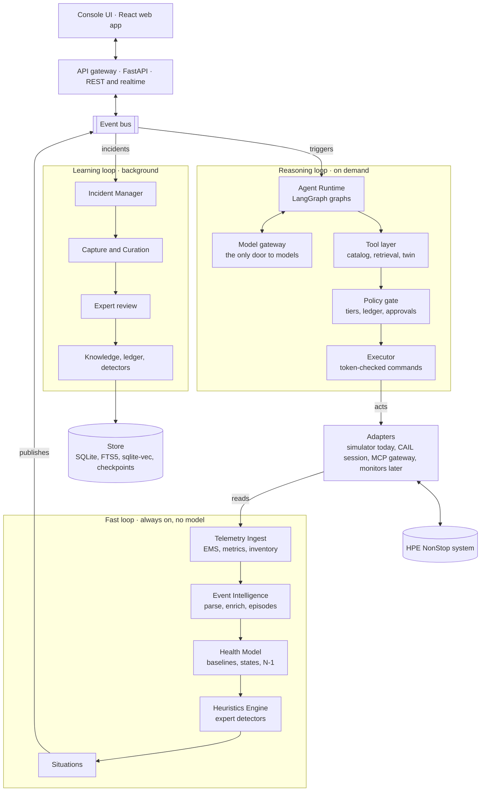
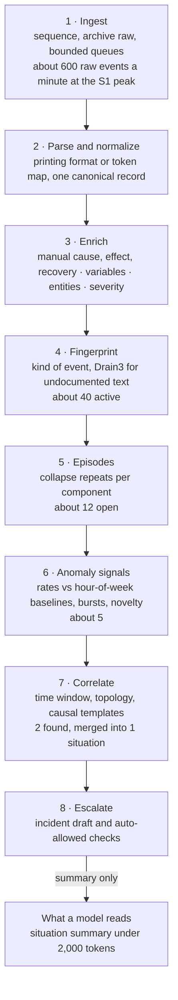
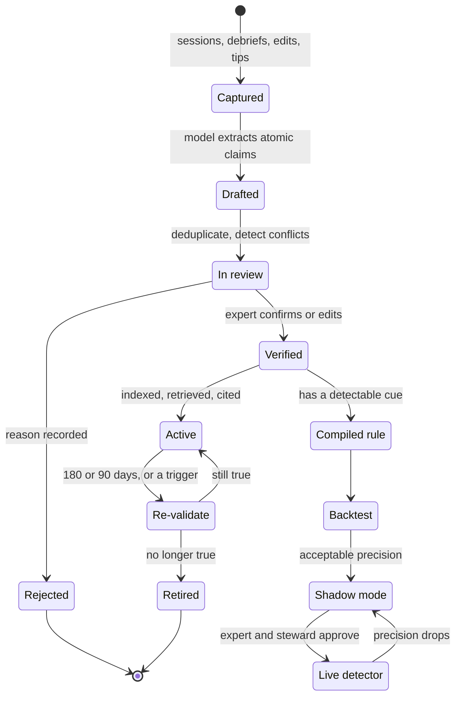
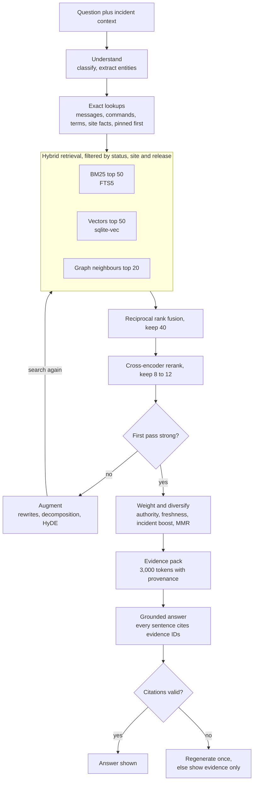
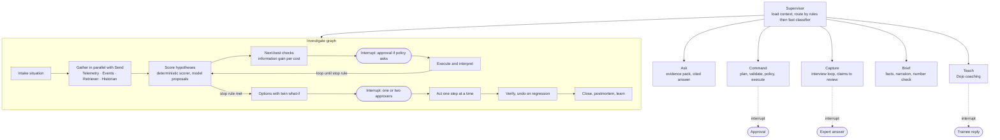
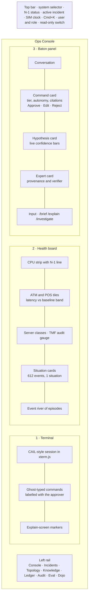

# Baton: Product and Technical Specification

Oct 16, 2026 · @Gajanan

## 1. Summary

**Baton is an AI operations co-pilot for HPE NonStop that sits beside the operator's terminal session.** It turns plain-language requests into governed commands, compresses the EMS event stream and performance telemetry into a live health model, captures and applies expert knowledge, and guides troubleshooting from first alert to verified recovery. Autonomy is earned command by command, and every action is attributable, explainable and, where possible, reversible.

### What Baton does

- **Commands (pillar 1).** Translates questions such as "why are ATM withdrawals slow?" into specific TACL, SCF, PATHCOM, TMFCOM or Measure commands drawn only from a vetted catalog. It explains each command, routes it through policy and approval, runs it, parses the output and explains the result. "Explain this screen" works in reverse on any terminal output.
- **Health (pillar 2).** Ingests hundreds of EMS events per minute plus metrics. It normalizes, enriches, de-duplicates and correlates them into a handful of situations tied to components and business services, and maintains baselines, N-1 headroom and a component health model with reasons.
- **Expertise (pillar 3).** Captures expert judgment from shadowed sessions, debrief interviews, corrections and approval decisions. It turns that judgment into claims, playbooks and executable heuristics, routes everything through expert review, and keeps knowledge fresh through usage tracking and re-validation.
- **Troubleshooting (pillar 4).** Runs hypothesis-driven diagnosis, picks the next most informative safe check and estimates blast radius. It presents options with effects predicted by a digital twin, executes approved actions with undo and verification, and writes the incident record.

### How it works, in one paragraph

A deterministic core does everything that must be exact: parsing, validation, policy, metrics, correlation, scoring, execution and audit. Language models work at the edges: understanding requests, planning from catalog entries, narrating evidence, interviewing experts and drafting knowledge. LangGraph runs these pieces as typed graphs with checkpoints, so any approval can pause a run and any incident can be replayed step by step. Hybrid retrieval (exact lookups, BM25, vectors and reranking) grounds every answer in HPE manuals, site facts and verified expert knowledge. A simulator stands in for NonStop and doubles as a digital twin for what-if analysis, training and evaluation.

### Design tenets

1. **Grounded or silent.** Every command and claim traces to a catalog entry, a manual section, a site fact or a verified expert; otherwise Baton says it does not know and names who to ask.
2. **Deterministic where it matters.** Code decides what is valid, safe and true about the system; models decide how to say it and what to look at next.
3. **Capabilities, not shells.** Nothing a model types reaches NonStop; only rendered catalog entries do.
4. **Earned, revocable autonomy.** Granted per command template and per role, on evidence, and withdrawn on any miss.
5. **The model never reads the firehose.** It reads situations and evidence packs, never raw event streams.
6. **Experts review claims, not transcripts.** Their time is the scarcest resource in the system.
7. **Complement, never replace.** Baton works through existing sessions and alongside existing monitors.

### Scope of this document

This specification covers the full product and its technical design: users and modes, the interface choice, architecture, integration paths, each pillar in depth, knowledge and retrieval, orchestration, the simulator, the front end, user journeys, the data model, the API, non-functional requirements, the stack and a build sequence. It is deliberately unconstrained; scoping to the sprint happens separately. Command names in examples follow HPE NonStop conventions, but exact syntax must be verified against the HPE manuals before any catalog entry is published.

## 2. Users, roles, modes and modules

**Baton serves seven roles through seven modes, built from seventeen modules; every module maps to at least one of CAIL's four pillars.** The names defined here are used throughout the rest of the spec.

### Roles

| Role | Who | Goal | Typical use | Autonomy ceiling |
| --- | --- | --- | --- | --- |
| Operator | Junior operator, 0 to 3 years (persona: Priya) | Keep services healthy without making things worse | Asks questions, runs checks, follows playbooks, approves read-only and some reversible commands | Earned auto-run for read-only checks; reversible actions need approval |
| Senior operator | Experienced shift operator | Resolve incidents fast | Approves reversible actions; first approver for impactful ones | Earned guarded auto-act for reversible actions |
| Expert | Veteran engineer near retirement (persona: Dave) | Pass on judgment with little effort | Reviews claims, runs capture sessions and interviews, grants autonomy, second approver | Can grant L2 autonomy for read-only templates |
| Shift lead | Accountable for service during a shift | Situational awareness and risk control | Reads briefs and incident status; second approver for impactful changes | Approver only |
| Steward | Owns the catalog, policies and models | Correctness and safety of what Baton can do | Curates catalog entries and policies, manages roles, grants L3 jointly with an expert | Administrative |
| Auditor | Risk and compliance | Accountability | Reads the audit log, replays incidents, exports evidence | Read-only |
| Trainee | Pre-production new hire | Build competence safely | Works simulated incidents in the Dojo | Simulator only |

### Modes

| Mode | Purpose | Main screen | Entered from |
| --- | --- | --- | --- |
| Ops | Everyday monitoring, questions and commands | Ops Console | Default landing |
| Incident | Structured investigation and response | Incident Room | A situation escalation, an "Investigate" click, or manual creation |
| Capture | Record expert sessions and run debrief interviews | Knowledge Studio, Capture tab | An expert starts a session |
| Review | Verify claims, playbooks, heuristics and catalog requests | Knowledge Studio, Review tab | Notifications and the review queue |
| Train | Practice simulated incidents with a coach | Dojo | Trainee or operator choice |
| Govern | Catalog, policies, trust ledger, audit | Ledger, Audit and Admin screens | Steward, expert or auditor |
| Direct | Drive the simulator for demos, tests and drills | Scenario Director | Hotkey, steward only |

### Modules

| Module | Responsibility | Pillars |
| --- | --- | --- |
| Adapters | One interface to NonStop: simulator now; CAIL session, MCP gateway and monitor APIs later | All |
| Telemetry Ingest | EMS and metric intake, sequencing, raw retention | 2 |
| Event Intelligence | Parse, enrich, fingerprint, group into episodes, detect anomalies, correlate into situations | 2, 4 |
| Health Model | Metric store, baselines, component states with reasons, N-1 headroom, briefs | 2, 4 |
| Command Catalog and Executor | Catalog, validation, rendering, execution, output parsing | 1 |
| Policy and Trust | Risk tiers, policies, trust ledger, approvals, audit, redaction | 1, 4 |
| Knowledge Store | Documents, chunks, indexes, entity graph, glossary | 3 |
| Retrieval | Query understanding, hybrid search, reranking, evidence packs | 1 to 4 |
| Capture and Curation | Shadow sessions, interviews, claims, conflicts, review, playbooks | 3 |
| Heuristics Engine | Compile expert rules into detectors; backtest, shadow-run, fire | 2, 3 |
| Diagnosis Engine | Failure-mode library, hypothesis scoring, next-best check, blast radius | 4 |
| Remediation and Verification | Options, what-if predictions, actions, undo, post-checks | 4 |
| Incident Manager | Incidents, timelines, status updates, postmortems | 4 |
| Agent Runtime | LangGraph graphs, sub-agents, model gateway, streaming | All |
| Simulator and Twin | Synthetic NonStop system, faults, scenarios, what-if runs | All |
| Console UI | Every screen and real-time view | All |
| Eval Harness | Retrieval, command, diagnosis and safety evaluation | All |

### Pillars to modules

| Pillar | Where it lives | What the user sees |
| --- | --- | --- |
| 1. Natural language to commands | Command Catalog and Executor, Policy and Trust, Retrieval, the Command graph | Command cards, approvals, explain-screen overlays |
| 2. Understand and monitor health | Telemetry Ingest, Event Intelligence, Health Model, Heuristics Engine | Health board, situation cards, briefs, N-1 indicator |
| 3. Preserve and apply expertise | Knowledge Store, Capture and Curation, Heuristics Engine, Retrieval | Expert cards, review queue, playbooks, coverage dashboard |
| 4. Guide troubleshooting and decisions | Diagnosis Engine, Remediation and Verification, Incident Manager, the Investigate graph | Hypothesis board, decision cards, timeline, postmortem |

## 3. Interface decision: a React web app, built API-first

**Build Baton as a React web application over an API-first backend.** Operators work in terminal emulators and monitoring consoles, not IDEs. The views that carry Baton's value (health board, topology, hypothesis board, approvals, expert review) are visual, real-time and shared across roles, which a browser does best.

| Option | Fit with operator workflow | Visuals and real-time | Multi-role use | Deployment in a bank | Fit with CAIL | Verdict |
| --- | --- | --- | --- | --- | --- | --- |
| React web app | High: sits beside the emulator, mirrors CAIL / Web | Excellent | Excellent | One internal URL, nothing to install | Can be embedded later in CAIL Suite as a web panel | **Primary** |
| CLI or terminal UI | Medium: suits power users | Poor for graphs, charts and diagrams | Weak | Easy | Matches terminal culture | Thin secondary client later |
| VS Code extension | Low: operators don't use VS Code | Medium, through webviews | Weak | Needs VS Code on locked-down desktops | Weak | Out of scope |
| Eclipse plugin | Low for operators; HPE's Eclipse environment (NSDEE) serves application developers | Medium | Weak | Needs Eclipse | Developer side only | Out of scope |
| Desktop wrapper (Tauri or Electron) | High | Excellent | Good | Needs installer approval | Could ship as a CAIL add-on | Later packaging of the same web app |
| Panel inside CAIL Suite | Highest: inside the session itself | Good, through an embedded webview | Good | Ships with CAIL Suite | Native | Production target, reusing the web app |

### Why not an IDE extension or a CLI first

- **IDE extensions target the wrong user.** HPE's [NonStop Development Environment for Eclipse](https://education.hpe.com/ww/en/training/docs/cds/HG754S.pdf) is for building and debugging C, COBOL, pTAL and Java applications. A "Baton for developers" (explain my application's EMS events, look up catalog entries) is a possible later product, not this one.
- **A CLI hides the parts that matter.** Commands run in a terminal, but Baton's value lies in correlation, evidence, approvals and expert review, which are visual and collaborative. A CLI can reuse the same API later, for example `baton ask`, `baton tail situations` and `baton approve`.

### Why React specifically

- **Every hard widget already exists:** xterm.js for the terminal, React Flow for topology and playbook graphs, Apache ECharts or Recharts for live charts, cmdk for a command palette, shadcn/ui for polished components.
- **AI coding agents are most reliable in React with TypeScript,** which matters when an agent builds most of the code.
- **Alternatives were weaker for this mix.** Svelte and Vue are viable but have thinner component ecosystems for these widgets. Server-rendered HTMX struggles with high-frequency dashboards. Streamlit and Gradio are fast to build but look generic and limit custom interaction, which hurts both usability and demo impact.

### Consequences for the architecture

1. **API-first.** Every capability is an API call or a realtime topic; the UI holds no business logic beyond presentation.
2. **Event-streamed.** The UI subscribes to topics (telemetry, situations, agent runs, approvals) rather than polling.
3. **Terminal pane as an adapter view.** In the MVP the terminal pane renders the simulator's session; in production the same pane is replaced by, or docked beside, the real CAIL session.
4. **Additive clients.** A CAIL Suite panel, a desktop wrapper, a CLI and chat-ops approvals (Teams or Slack) can all be added without backend changes.

## 4. System architecture

**Baton is one backend of cooperating services around an internal event bus, a SQLite-based store and a model gateway; the browser talks to it through REST and one realtime channel.** Three loops run on this architecture: a fast deterministic loop that is always on, a reasoning loop that runs on demand, and a learning loop that runs in the background.



The fast loop turns raw data into situations without any model; the reasoning loop reaches models only through the gateway; the learning loop feeds verified knowledge back, and only the executor's path reaches NonStop.

### Runtime components

| Component | Kind | Responsibility | Talks to |
| --- | --- | --- | --- |
| Console UI | React single-page app | Every screen; subscribes to realtime topics | API gateway |
| API gateway | FastAPI app | REST endpoints, realtime hub (WebSocket or server-sent events), authentication, validation | All services |
| Event bus | In-process async publish and subscribe (production: NATS, Redis Streams or Kafka) | Decouples producers from consumers | All services |
| Telemetry Ingest | Async workers | Pulls EMS streams, metric samples and inventory snapshots from adapters | Adapters, bus |
| Event Intelligence | Async workers | Normalizes, enriches, fingerprints, builds episodes, detects anomalies, correlates situations | Bus, store, message definitions |
| Health Model | Service | Metric store, baselines, component states with reasons, N-1 headroom, briefs | Bus, store |
| Heuristics Engine | Service | Evaluates expert detectors against events and metrics | Bus, store |
| Agent Runtime | LangGraph graphs | Supervisor graph and mode subgraphs; streams cards to the UI | Tool layer, model gateway, checkpointer |
| Tool layer | Python functions with typed inputs and outputs | Catalog, validator, renderer, executor, parsers, policy, retrieval, telemetry queries, topology, twin | Adapters, store |
| Knowledge services | Batch jobs plus a service | Ingestion, indexing, retrieval, curation, conflict detection | Store, model gateway |
| Incident Manager | Service | Incident lifecycle, timeline, status updates, postmortem | Bus, store |
| Scheduler | Periodic jobs | Baseline recomputation, inventory refresh, re-validation reminders, eval runs, retention | Services |
| Model gateway | Service | Routes each task to a model tier, plus embeddings, reranking, caching, replay and cost tracking | Hosted or local models |
| Adapters | One interface, several implementations | Simulator in the MVP; CAIL session, MCP gateway, monitor APIs and file drops later | NonStop or simulator |
| Store | SQLite in WAL mode with FTS5 and sqlite-vec; a checkpoint database; a blob folder | Persistence behind repository classes, so PostgreSQL can replace SQLite later | All services |

### Internal topics

| Topic | Carries | Main consumers |
| --- | --- | --- |
| `ems.raw` | Raw event records with source and sequence number | Event Intelligence, raw archive |
| `ems.event` | Normalized, enriched events | Episodes, heuristics, UI event river |
| `events.episode` | Episode created or updated | Correlator, UI |
| `metrics.sample`, `metrics.rollup` | Metric samples and one-minute rollups | Health Model, heuristics, UI charts |
| `signals.anomaly` | Metric and event-rate anomalies | Correlator, heuristics |
| `situations.changed` | Situation opened, updated, resolved or suppressed | Incident Manager, Agent Runtime, UI |
| `health.changed` | Component state transitions with reasons | UI, briefs |
| `heuristics.fired` | An expert detector matched | Correlator, UI |
| `incidents.changed` | Incident lifecycle events | UI, Scribe |
| `agent.stream.{thread}` | Graph node events, cards, tokens, interrupts | UI |
| `approvals.changed` | Approval requested, decided or expired | UI, Agent Runtime |
| `knowledge.changed` | Knowledge items added, verified or retired | Indexer, retrieval caches |
| `sim.changed` | Simulator clock and scenario state | UI, Director |

### The three loops

- **Fast loop (seconds, deterministic, always on).** Adapters feed ingest; Event Intelligence, the Health Model and the Heuristics Engine turn raw data into situations and component states; the UI updates live. No model is involved, so this loop keeps working if every model is down.
- **Reasoning loop (on demand).** A user message or a situation escalation starts an agent run. The run calls tools (retrieval, telemetry queries, catalog, policy), pauses at approval gates, and executes through the adapter. The resulting events and metrics flow back through the fast loop, which is how verification sees the effect.
- **Learning loop (background).** Incidents, corrections, approvals and interviews feed curation and expert review. Verified results update the knowledge store, the trust ledger and the heuristics, so the next incident starts smarter.

### Deployment views

- **Demo and development:** one machine running a single Python process (API, background workers, simulator, agent runtime) plus the built front end; SQLite files on disk; hosted model APIs or a local model.
- **Production at a CAIL customer:** containers on premises inside the bank network: API and realtime, ingest and intelligence workers, agent runtime, model gateway with an on-premises model server, PostgreSQL with pgvector (or SQLite per site), and a message bus. Adapters run beside the CAIL session servers, identity comes from the bank's single sign-on, and an active-passive pair provides availability.

## 5. Connecting to NonStop and existing tools

**Everything Baton reads from or does to a NonStop system passes through one Adapter interface.** The MVP implements it with the simulator; production implementations reuse CAIL's 6530 session, governed gateways and the monitors customers already run.

### The adapter interface

| Capability | Returns | Simulator implementation | Production source |
| --- | --- | --- | --- |
| `execute(command, context)` | Raw text output, status, timings, session ID | Command handlers read or change the model | The operator's CAIL 6530 session driven by CAIL's automation interface, or a tool on a governed gateway |
| `stream_events()` | Async stream of raw EMS records, as printed text or token maps | Emitter using real message templates plus background chatter | A printing distributor in a CAIL session, a consumer distributor, log-streaming products, monitor feeds |
| `poll_metrics()` | Samples of entity, metric, value and timestamp | Model state on every tick | Measure reports or exports, monitor APIs, parsed status commands |
| `snapshot_inventory()` | Components and relationships: CPUs, processes and pairs, server classes, volumes, lines, TMF configuration | Model topology | Scheduled read-only INFO and STATUS commands, a CMDB, the site file |
| `read_screen()` | The current terminal buffer, as text or block-mode fields | The simulated session buffer | CAIL's screen interface |
| `probe()` | Adapter health, latency and privileges | Always healthy | Connection checks |

Contract rules for every adapter:

- **Dumb pipes.** Adapters contain no business logic; parsing, policy and interpretation live elsewhere.
- **Execution tokens.** `execute` accepts only a rendered catalog command accompanied by a short-lived token signed by the Policy module for that exact text and approval. No other code path, and no model output, can execute anything.
- **Correlation IDs.** Every call carries one, and it lands in the audit log.
- **Limits.** Timeouts, output-size caps and per-target rate limits apply in the adapter itself.
- **Redaction at the edge.** Output is redacted before it leaves the adapter (see the security boundary below).

### Reading EMS events

EMS collects event messages from subsystems into the primary collector `$0` (or the alternate collector `$ZLOG`), which writes an event log. Distributor processes read that log through a filter: printing distributors format text for terminals and files, consumer distributors serve applications, and forwarding distributors send events to another node's collector ([Operator Messages Manual, ch. 1](https://ftp.hp.com/pub/softlib/NonStopOpMsgsMnl/ch01.html)). Baton can tap that flow four ways:

| Option | How | Strength | Cost |
| --- | --- | --- | --- |
| 1. Printing distributor in a CAIL session (recommended first) | Run a printing distributor against `$0` with output to the session and an optional compiled filter, following the documented `EMSDIST TYPE P, COLLECTOR $0, TEXTOUT ..., FILTER ...` pattern ([example](https://groups.google.com/d/topic/comp.sys.tandem/Jar3hr2QFrE)) | No new NonStop software; the same text operators already see | Tokens are flattened into text, so Baton must parse it |
| 2. Consumer distributor | A small reader, on NonStop or behind a gateway, receives events with full tokens: subsystem ID, event number, subject, generation time | Fully structured and filterable | Needs NonStop-side software to be approved |
| 3. Existing pipelines | Forwarding distributors to a central node; the Open Notification Service, which turns `$0` events into SNMP traps for a network manager ([ch. 69](https://ftp.hp.com/pub/softlib/NonStopOpMsgsMnl/ch69.html)); log-streaming products such as comforte SafePoint Logstream, which streams EMS and security logs to a SIEM over syslog ([fact sheet](https://www.comforte.com/resources/fact-sheet-safepoint-logstream)); monitor feeds | Nothing new to install where these already run | Vendor-specific formats |
| 4. File drops | EMS log extracts | Backfill, replay and heuristic backtesting | Not real time |

The printing-distributor format is what the MVP parser targets: date and time, origin (system plus process or CPU), subsystem ID as `owner.subsystem.version`, event number, then text. Critical events carry an asterisk two columns before the subsystem ID.

### Reading metrics and inventory

- **Measure.** Production consumes existing Measure collections, through reports, exports or a monitor's API, as summarized samples (CPU busy, process busy, disk, TMF). Granularity of one to five minutes is acceptable to the health model.
- **Status polling.** Scheduled read-only catalog checks (Pathway server-class status, disk status, TMF status) are parsed into metrics and states. They run under a service identity with its own trust-ledger lane.
- **Inventory.** Daily and on-change snapshots, plus an operator-maintained site file that maps components to business services (ATM and POS authorization), owners and criticality.

### Acting on the system

- **Operator session path (default).** Commands appear in the operator's own CAIL session, under their NonStop user ID and their Safeguard or XYGATE rules. Baton never holds the operator's password; the session is already authenticated.
- **Service path.** A dedicated least-privileged user, with no write privileges at all, runs scheduled read-only polling.
- **Gateway path.** Governed MCP tools, for example from Infrasoft's [uLinga Nexus](https://connect2nonstop.com/bridging-worlds-ai-meets-nonstop-through-model-context-protocol/) MCP server, expose specific operations with authentication profiles and a trace record for every request; catalog entries map onto those tools.
- **Guards on every path.** Execution tokens, rate limits per template and per target, one state-changing action at a time per incident, a global read-only switch, a kill switch and session recording.

### Security boundary

- **Data minimization.** Baton reads system metadata (states, counts, names, messages), never application payloads or databases. Card and customer data are out of scope.
- **Redaction.** All adapter text passes a redactor before storage or any model call: card numbers detected by pattern plus Luhn check, account-number patterns, and optionally user IDs and addresses.
- **Untrusted content.** EMS text, command output, documents and screens are data, never instructions. Process names, file names and application messages can carry attacker-influenced strings, so prompts delimit them, models are told never to act on instructions inside them, outputs are schema-validated, and only catalog commands can run.
- **Secrets.** Never placed in prompts; the model gateway strips known secret patterns; keys live in a vault.
- **Model placement.** Hosted APIs for the prototype; an on-premises model for banks that prohibit egress. The gateway makes this a configuration change.
- **Identity and access.** Single sign-on in production and local accounts in the MVP; every request carries user and role into the audit log.

### Optional integrations

- **Ticketing (ServiceNow, Jira):** create and update incidents, attach timelines, import historical tickets into the knowledge base.
- **Chat (Teams, Slack):** situation notifications and approval requests with deep links; impactful approvals still require an authenticated confirmation in Baton.
- **Monitors (Prognosis, Web ViewPoint Enterprise, OSM):** import their alerts as signals and deep-link from situations to their views.

## 6. Pillar 2a: the EMS event pipeline

**Hundreds of EMS events per minute become a handful of situations through an eight-stage deterministic pipeline; no language model ever reads the raw stream.** The model sees compact situation summaries with manual excerpts, which is cheaper, faster and far harder to mislead.



Stages 1 to 8 are deterministic code; the volumes are the S1 design targets, and only the final summary reaches a model.

### Design goals

- **Throughput:** 300 to 1,000 events per minute nominal, 10,000 per minute in storms; constant work per event through cached lookups, in-process asyncio, bounded queues.
- **Latency:** event arrival to situation update under 2 seconds at the 95th percentile.
- **Lossless audit, lossy display:** every raw event is kept; the UI shows episodes and situations, never a wall of raw lines.
- **Explainable:** every situation can show which events, rules and baselines produced it.

### Stage 1: ingest

- Adapters publish raw records to `ems.raw` with source ID, ingest timestamp, a monotonic sequence number, and the raw text or token map.
- Raw records go to an append-only archive (a table plus compressed daily files), kept 7 days in the MVP.
- Backpressure: queues are bounded. When full, known-noisy fingerprints drop to count-only processing and the pipeline raises a `pipeline.degraded` signal that the UI shows.

### Stage 2: parse and normalize

- **Printing-format parser.** A header pattern extracts date and time, origin (system name, process name or CPU number), the critical marker, the subsystem ID (`owner.subsystem.version`) and the event number. The rest is message text; continuation lines are joined until the next header.
- **Token mapper.** For consumer-distributor or gateway feeds, tokens map directly: subsystem ID, event number, generation time, subject, text.
- **Canonical event record:** ID, generated time, ingested time, system, origin process, origin CPU, owner, subsystem name and number, version, event number, critical flag, text, subject, tokens, source, raw reference.
- **Clock handling:** order by generated time; detect skew against ingest time; flag late events but still process them.

### Stage 3: enrich

1. **Message definition lookup.** Key on subsystem plus event number to fetch the Operator Messages Manual entry: template text with variables, cause, effect and recovery. Negative numbers resolve to the common-message chapters. Unknown messages are flagged "undocumented" and still processed.
2. **Variable extraction.** Each template compiles once into a pattern whose variables (CPU, logical device, server class, error number) become named fields. A match yields structured values, such as the server class and file error behind a Pathway link failure.
3. **Entity resolution.** Extracted subjects (process names, CPU numbers, server classes, volumes, lines) map to topology component IDs through the inventory. Unresolved subjects become "unknown entity" chips.
4. **Severity normalization.** A 1 to 5 severity from the critical flag, the message's effect text (words such as "stops", "crashes", "cannot"), site overrides for known-benign events, and maintenance windows.
5. **Site annotations.** Noisy-event lists, owning team, runbook links.

### Stage 4: fingerprint and template mining

- **Fingerprint** = subsystem, event number, component class and template. It means "the same kind of thing happening to the same kind of component".
- **Template mining for undocumented text.** Application events, user-written EMS messages and anything without a manual entry go through [Drain3](https://pypi.org/project/drain3/), an online template miner, fed only the text portion. Masking rules cover NonStop identifiers (`$` process names, `\` system names, numbers, hex values, times). Mined templates persist and a steward can name them.
- **Novelty.** A fingerprint not seen in 30 days raises a "new event type" signal, often an early warning.

### Stage 5: episodes

- **Episode key:** fingerprint plus component (or entity tuple).
- **Lifecycle:** open on the first event; extend while events keep arriving within a gap timeout (120 seconds by default); close after inactivity.
- **Statistics:** count, first and last seen, current rate, peak rate, maximum severity, a few exemplar events, and the distribution of variable values (for example, which server classes are affected).
- **Display:** "PATHWAY 1007 CAN'T GRANT LINK, 212 times on ATM-AUTH in 3 minutes" replaces 212 identical lines.

### Stage 6: anomaly signals

- **Event-rate anomalies.** Each fingerprint's rate is compared with its hour-of-week baseline (median and median absolute deviation over recent weeks). A robust z-score must persist across 2 of 3 windows before a signal fires.
- **EMS burst reports.** Collectors and distributors report event bursts themselves; those messages become high-value signals.
- **Metric anomalies** from the Health Model (section 7) arrive on the same topic.
- **Heuristic hits** from expert detectors (section 10) arrive with their provenance.

### Stage 7: correlate into situations

Correlation is a deterministic algorithm, not a model call:

1. **Candidate groups** form from signals within a time window (5 minutes by default) and close in the topology: the same component, or within two hops (CPU, then the processes on it, then server classes with servers there, then the business service).
2. **Causal templates** name and strengthen groups. Examples: processor down, then process takeovers, then Pathway link errors, then a latency anomaly on a dependent service; or audit trail fill rising, then overflow events, then transaction-begin warnings.
3. **Origin candidate.** The most upstream component with a signal is marked as the starting point for investigation; it is a lead, not a diagnosis.
4. **Merge and split.** Groups sharing components inside the window merge; groups separated by more than the window with no causal link split.

A situation records its title, severity (raised when a business service is affected), status, origin candidate, components, affected business services, member episodes and signals, first and last activity, counts of raw events and episodes, suggested playbooks, linked manual entries and a confidence. Its lifecycle runs open, updating, stable, resolving and resolved; a user can suppress it with a reason, which feeds learning.

### Stage 8: escalate and hand off

- **Escalation rules:** severity 4 or above, an affected business service, or an expert heuristic marked "page" creates an incident draft and notifies the shift.
- **Pre-investigation:** optionally, the agent runtime starts a run that executes only checks the trust ledger already allows to auto-run, so evidence is waiting when the operator opens the incident.
- **What the model receives:** a compact structure with title, components, member episodes (fingerprint, counts, rates, exemplar text, manual cause, effect and recovery), anomalies (expected versus observed) and a timeline. A situation built from about 300 raw events typically fits in under 2,000 tokens.

### Design-target volumes for the hero scenario

| Stage | Per minute at peak in scenario S1 |
| --- | --- |
| Raw events, including background chatter | About 600 |
| Active fingerprints | About 40 |
| Open episodes | About 12 |
| Anomaly signals | About 5 |
| Situations | 2, merged into 1 by the CPU-loss causal template |
| Incidents | 1 |

### What the operator sees

- **Event river:** a live ticker of episodes, coloured by severity, with counts that tick up; a click opens the raw events and the manual's cause, effect and recovery.
- **Situation cards:** title, severity, components, "612 events, 1 situation", age, affected services, suggested playbook, and an Investigate button.
- **Explain this event:** the manual entry, site notes and verified expert claims for that message, side by side.

## 7. Pillar 2b: metrics, baselines and the health model

**Metrics become a component-level health model with reasons: every state says what changed, against which baseline, what it puts at risk, and whether the system can still survive losing one more CPU.** Like the event pipeline, all of this is deterministic; the model only narrates it.

### Metric catalog

Each metric definition records name, unit, entity type, source, sampling interval, aggregation, static thresholds, baseline policy, owner and display hints.

| Entity | Metrics | Why it matters |
| --- | --- | --- |
| Processor (CPU) | Busy %, ready-queue length, dispatch rate, memory pages in use, page-fault rate, state (up, down, reloading) | Saturation, failure, N-1 headroom |
| Process | Busy %, priority, message-queue depth, state, CPU, backup CPU | Runaway loops, starvation, process-pair health |
| Pathway server class | Requests per second, mean and 95th-percentile response time, servers running versus maximum, queued requests or link waits, errors | The main transaction path for ATM and POS |
| TMF | Transactions per second, abort rate, audit trail fill % per trail, distance to the overflow and begin-transaction-disable thresholds, dump status | Transaction safety and capacity |
| Disk volume | I/O rate, request queue, cache hit %, path state of each mirror half (up, down, hard down, revive) | Mirroring and latency |
| Expand line | State, throughput, retransmits | Connectivity between nodes |
| TCP/IP stack | Connections, errors, state | Connectivity to payment switches |
| Business service | ATM and POS authorizations per second, approval rate, 95th-percentile latency, timeouts | What customers feel |
| Baton pipeline | Events per minute, queue depth, degraded flag | Trust in Baton itself |

### Storage and resolution

- **Hot:** in-memory ring buffers per series, the last 2 hours at native resolution (5 seconds in the simulator).
- **Warm:** one-minute rollups (minimum, mean, maximum, 95th percentile, last) in SQLite for 30 days.
- **Cold:** one-hour rollups for a year.
- **Production granularity** depends on the source; Measure intervals or monitor APIs at 1 to 5 minutes are acceptable.

### Baselines and anomaly detection

- **Seasonal profile:** hour-of-week median and median absolute deviation (MAD) per series over the last 4 to 8 weeks. The simulator generates 8 synthetic weeks so baselines exist from the first minute.
- **Calendar overlays:** a table of special days (Black Friday, Christmas Eve, month-end, payroll days, Easter) with expected multipliers, learned from history or set by experts. The expected value is the profile times the multiplier.
- **Short-term level:** an exponentially weighted moving average catches level shifts the weekly profile misses.
- **Anomaly rule:** robust z = (observed − expected) / (1.4826 × MAD). A signal fires when the absolute z is at least 4 in 3 of the last 5 samples and the absolute change exceeds a minimum material amount, which suppresses noise at low values.
- **Static guards always apply,** whatever the baseline says: for example CPU busy at or above 90%, or an audit trail within a set margin of its overflow threshold.
- **Output:** each signal carries metric, entity, observed value, expected band, score, duration and direction.

### Derived signals

- **N-1 headroom.** Every minute, simulate losing each CPU using the process-pair map: each primary on the lost CPU moves its load to its backup's CPU, and servers on the lost CPU disappear until restarted elsewhere. Publish the worst survivor's busy and the predicted latency effect, for example "N-1 unsafe: losing CPU 3 puts CPU 5 at 97%". This is the clearest single number for peak-season risk.
- **Time to threshold.** A linear or Holt trend on audit trail fill, disk space and queue growth: "the audit trail reaches its overflow threshold in about 22 minutes at the current rate".
- **Little's-law check for Pathway.** Queue length should roughly equal arrival rate times waiting time; a mismatch flags blocking or a measurement problem.
- **SLO burn.** Error-budget burn rate for business-service latency and timeouts; a fast burn pages the shift.

### The health model

- **Component graph.** Nodes are the system, CPUs, processes, process pairs, server classes, TMF and its audit trails, volumes, lines, the TCP/IP stack, batch jobs and business services. Edges are runs-on, backup-on, serves, depends-on, writes-audit-to, uses-volume and connects-via. It is built from inventory snapshots plus the site file.
- **States:** OK, Degraded, Critical, Down and Unknown, each with reasons: the contributing signals, situations and rule IDs, with values against thresholds or baselines.
- **Rules as data.** A rule table per component type, for example: a CPU is Down if its state is down, Critical if busy is at least 95% for a minute, Degraded if its anomaly score is at least 4 or N-1 is unsafe. A server class is Critical when all servers are running, requests are queuing, and latency exceeds its target.
- **Propagation.** Dependents inherit an "at risk" flag, not a full state, when a dependency is Degraded or worse. Redundancy dampens it: a process pair with a healthy backup does not propagate Down.
- **Flap control.** Different enter and exit thresholds, plus a minimum dwell time in each state.
- **Events.** Every transition publishes `health.changed` with the before and after states and the reasons, which the UI shows on hover.

### System briefs

- **When:** on demand ("how are we doing?") and on a schedule (shift start, handover, every 4 hours during peaks).
- **Facts first.** Gather active situations and trends, components not OK, N-1 status, top anomalies, forecasts that cross a threshold within the shift, changes since the last brief (situations opened and resolved, configuration changes, actions taken), and upcoming calendar risks such as batch windows and peak days.
- **Then narration.** A fast model turns the fact sheet into five to eight sentences, each citing fact IDs. A numeric consistency check confirms every number in the text matches a fact; on failure Baton regenerates or shows the facts alone.
- **Format:** a green, amber or red headline, three bullets (what changed, what is at risk, what to do), and drill-down links.

### Peak readiness

Before a known peak, Baton runs the twin (section 14) at forecast peak load with each single-CPU loss, lists the cases where a service would breach its target, and proposes pre-emptive moves as a checklist: shift batch windows, pre-start servers, rebalance process pairs. These are suggestions only; any resulting command goes through the normal command path.

## 8. Pillar 1: natural language to governed commands

**Baton never writes command text. It chooses catalog entries and fills typed parameters, a validator checks them against live inventory, policy decides who must approve, and a renderer produces the exact text.** The same machinery runs in reverse to explain any screen.

### The command catalog

| Field | Purpose | Example |
| --- | --- | --- |
| `id` | Stable key | `pathway.status_server` |
| `title`, `description` | Text for cards | "Show the status of a Pathway server class" |
| `interpreter` | Which utility, and how it is entered (one-shot or inside an interactive prompt) | PATHCOM, addressed to the PATHMON process |
| `template` | Command text with typed placeholders | `STATUS SERVER {server_class}` |
| `parameters` | Name, type, constraints, source of valid values, default | `server_class`: one of the inventory's server classes |
| `risk_tier` | T0 to T3 (section 9) | T0, read-only |
| `side_effects` | State or performance effects | None |
| `reversible`, `undo_template` | Whether and how to reverse it | `ACTIVATE {process}` reverses `SUSPEND {process}` |
| `preconditions` | What must hold before running | Process exists and is not on the protected list |
| `verification` | Post-checks and expected results | Rerun status; expect the server class running |
| `parser` | Output parser and the facts it produces | State, servers running, requests queued |
| `doc_refs` | Manual and section | TS/MP management manual, PATHCOM STATUS |
| `examples` | Utterances mapped to filled commands | "is ATM auth healthy?" maps to status of `ATM-AUTH` |
| `aliases` | Synonyms that aid retrieval | "server class", "Pathway servers" |
| `applicability` | Release and site scope | L-series, site TORBANK |
| `status`, `steward`, `version` | Lifecycle and ownership | Active, ops steward, v3 |

**Size and coverage.** The MVP catalog holds 40 to 60 entries: read-only checks across TACL (process status), PEEK, SCF (processes, disks, lines), PATHCOM (PATHMON and server-class status, info and statistics), TMFCOM (TMF and audit-trail status), Measure reports, EMS distributor filters and file information, plus 10 to 15 reversible or impactful actions (suspend and activate a process, start or stop servers in a class, freeze a class). Every entry must be verified against the manuals; anything unverifiable stays in draft.

**Authoring.** A steward drafts entries from manual sections; Baton can propose drafts from manual chunks, but a human verifies syntax, tier, preconditions and parser. Each entry ships with a render test and parser tests on sample outputs, and every change is versioned.

### The request pipeline

1. **Classify intent:** a state question, a command request, an explanation, an investigation, a knowledge question, or chat. A fast model plus rules (imperative verbs, catalog keywords) decides.
2. **Extract and resolve entities:** CPU numbers, process names, server classes, volumes, lines, time ranges and the system. Each is resolved against inventory, exactly, case-insensitively, then fuzzily; ambiguity triggers one clarifying question with choices.
3. **Retrieve candidates:** hybrid search over catalog titles, descriptions, aliases and examples, plus the nearest past utterances from the example bank and steps suggested by matching playbooks. About ten candidates survive.
4. **Plan with the model:** the input is the request, resolved entities, the candidate entries (the only IDs allowed), site facts and recent context. The output is a schema-bound plan: steps with catalog ID, parameters, purpose, dependencies and parallel group, plus rationale, expected observations and confidence.
5. **Validate deterministically:** schema, parameter types and ranges, values present in inventory, live preconditions, conflicts (no state-changing step while another is in flight; no protected entities; no freeze windows unless allowed), duplicates and size limits. On failure the model gets the exact error and up to two repair attempts, then Baton asks the user.
6. **Evaluate policy:** tier, trust ledger, role and context produce a decision per step: auto-run, approval by one or two people, or blocked with a reason.
7. **Build cards:** rendered command preview, plain-English purpose, why now (linked to the hypothesis or evidence), expected output, risk and side effects, undo, citations, autonomy badge and decision buttons.
8. **Gate:** auto-run steps proceed; the rest raise an interrupt. An approver may edit parameters (re-validated) or reject with a required reason.
9. **Render and execute:** the renderer fills the template with interpreter-specific escaping, requests an execution token from Policy, and the adapter runs it in the session. Read-only steps in one parallel group run concurrently up to a cap.
10. **Parse:** the registered parser turns output into facts. If it fails, a model extracts the same schema and the result is flagged low-confidence; raw output is always kept.
11. **Interpret:** compare facts with expectations, baselines and thresholds, then explain what the output shows, what is notable and what to check next, citing manual sections for each field.
12. **Learn:** store the utterance, plan and outcome. Approvals, edits and rejections update the trust ledger and the example bank; parse failures open parser tickets; unmatched requests open catalog requests.

### Multi-step plans

- **Small graphs of steps.** "Check ATM health" becomes: look up the ATM service's server classes (a site fact), check each class's status in parallel, read CPU busy for the CPUs hosting them, then summarize.
- **Fan-out from inventory.** A step can range over an inventory set ("every server class of the ATM service"), expanded deterministically before validation.
- **Streaming results.** Each step's card updates as it finishes.
- **Limits.** At most 12 steps per plan and 6 concurrent read-only executions; state-changing steps always run one at a time.

### Clarifying and refusing

- **One question at most,** with two to four choices. If the user does not answer within the flow, Baton defaults to a broader read-only check.
- **No catalog match:** Baton says so plainly, shows the closest safe alternatives, and files a catalog request to the steward with the user's wording. It never improvises a command.
- **Blocked commands** (T3, or denied by policy): Baton explains why and names the human path: who can do it and which manual section applies.

### Explain this screen

- **Input:** selected terminal text or the whole buffer; for block-mode application screens, the field map from the CAIL session (labels, values, attributes).
- **Recognition, in order:** use the parser of the Baton-executed command that produced the screen; otherwise match the screen's signature (header lines, column titles) against the parser registry; otherwise ask the model for an explanation grounded in retrieved manual chunks, marked "unrecognized format".
- **Output:** annotations anchored to lines or fields, each with label, meaning, normal range, whether the current value is unusual against baselines, and a catalog-backed next check, under a one-paragraph summary.
- **In the UI:** numbered markers overlay the terminal; hovering shows the note; an annotation can be pinned to the incident timeline.
- **Siblings:** "Explain this event" for EMS lines (manual entry plus site notes plus expert claims) and "Teach me this command" (manual excerpt, an example, and how experts read the output).

### Learning from use

- **Example bank.** Every approved plan becomes an example of utterance, context summary and plan. Approval without edits scores high; an edited plan is stored in its corrected form.
- **Few-shot retrieval.** The three most similar examples join step 4's context, so accuracy improves with use and without fine-tuning.
- **Gap tracking.** Unmatched requests are clustered weekly into the steward's backlog.
- **Synthetic seed.** Before launch, the model writes 5 to 10 paraphrases per catalog entry; a round-trip test keeps only those the planner maps back to the right entry.

## 9. Safety and governance

**Safety is enforced in code at the point of execution: risk tiers, a policy engine, an earned-autonomy trust ledger, approvals, undo and a tamper-evident audit log.** There is no path by which model output alone changes the system.

### Risk tiers

| Tier | Meaning | Examples | Default gate |
| --- | --- | --- | --- |
| T0 Read-only | No state change, negligible load | Status and info queries, PEEK, EMS reads, Measure reports | One approval until earned; can earn auto-run |
| T1 Reversible | State change with a tested inverse and bounded blast radius | Suspend then activate a named batch process; start extra servers in a class (inverse: stop them); lower a batch job's priority | Approval plus a recorded undo; can earn guarded auto-act |
| T2 Impactful | Configuration or service-behavior change; the inverse may be partial | Alter server-class attributes; stop or freeze a server class; change TMF parameters | Two approvals, one from a senior operator or expert; never automatic |
| T3 Destructive | Irreversible or outage-capable | Purge files, abort a disk, stop TMF, reload or stop a CPU | Blocked in Baton; human-only, outside the assistant |

Tier belongs to a catalog entry plus a parameter class, so the same template can carry different tiers: starting servers in a non-critical class is T1, in a critical class T2.

### Policy engine

- **Policies are versioned data** (YAML), hot-reloaded on change. Each rule matches on role, tier, template, target tags, environment, time window or calendar (such as a peak freeze), incident state and autonomy level. Its effect is auto-allow, require approval (how many people, which roles) or deny with a reason. Obligations attach to effects: record an undo, notify the shift lead, apply a rate limit.
- **Evaluation:** deny overrides allow; the most specific allow wins; T3 defaults to deny and everything else defaults to approval.
- **Explainable decisions:** every decision carries the matched rule IDs and a sentence such as "Requires approval: T1 action; ledger level L1 for role Operator".
- **Tested:** table-driven unit tests run in CI, plus a property test that no rule can auto-allow T2 or T3.
- **Example rules:** during a declared peak freeze, only T0 and listed playbook T1 actions are allowed; protected processes (system processes, TMF, PATHMON) cannot be targeted by T1 or T2 without expert approval; at most three state-changing actions per incident in any 10 minutes.

### Trust ledger and earned autonomy

- **Key:** template, parameter class, role and environment. Parameter classes group targets, such as "batch processes" or "non-critical server classes".
- **Counters:** proposed, approved unchanged, edited, rejected (with reason codes), executed, verified OK, verification failed, undone, incidents attributed.
- **Levels:** L0 suggest, L1 run on approval, L2 auto-run (T0 only), L3 guarded auto-act (T1 only, inside guardrails); T3 is never eligible.
- **Promotion:** a candidate appears when thresholds are met. For example, L1 to L2 needs 20 runs approved unchanged, no rejections in the last 20 and at least 2 distinct approvers; L2 to L3 for T1 needs 10 approved runs, no verification failures and an undo tested at least 3 times. A human grants it with a reason: an expert for L2, an expert plus a steward for L3. Grants expire after 90 days unless renewed.
- **Demotion:** immediate, by one level or to L1, on any rejection with a safety reason, any verification failure, any undo after an auto-act, or any attributed incident. The grantor is notified.
- **Visible on every card:** "Auto-run: L2, granted by Dave on Sep 2 after 214 clean runs". The ledger screen shows the whole matrix and its history.

### Approvals

- **Request:** plan steps, rendered commands, evidence links, risk, undo, the policy decision, required approvers and an expiry.
- **Decisions:** approve; edit (changed parameters are re-validated and re-evaluated, and the edit counts as a learning signal); reject with a reason code (wrong command, wrong target, unsafe now, not needed, other) and optional text.
- **Two-person rule:** the second approver is a different user with an eligible role; both identities are recorded; for T2 the second approval must happen in Baton, not in chat.
- **Expiry:** approvals lapse after a few minutes because state changes; a lapsed approval needs re-validation.
- **Batching:** a set of read-only checks can be approved together.

### Undo and verification

- **Undo stack per incident.** Every executed T1 or T2 action pushes its inverse (or a compensating plan) with preconditions and verification.
- **Post-action verification.** Run the entry's verification checks, compare expected with observed, and watch health and service metrics over a short window (2 to 5 minutes).
- **No-regression rule.** If service metrics worsen beyond tolerance after an action, Baton proposes the undo immediately; it undoes automatically only at L3 and only if policy allows. The ledger records the failure either way.
- **Write exclusivity.** One state-changing action at a time per incident and per target.

### Audit log

- **Append-only entries:** timestamp, actor (user, agent node or system), action, target, rendered command, policy decision and rule IDs, approvals, evidence IDs, model and prompt hash for model-originated proposals, a hash of the execution result, correlation IDs.
- **Tamper evidence:** each entry stores a hash of the previous entry's hash plus its own content; a verification endpoint recomputes the chain, and a daily anchor is exported.
- **Replay:** LangGraph checkpoints plus audit entries reconstruct any incident step by step.
- **Export:** CSV or JSON for auditors.

### Untrusted input and model safety

- **Data, not instructions.** All external text sits inside delimited data blocks in prompts, and system prompts state that data never carries instructions.
- **Structured outputs drive behavior.** Plans, scores and claims are schema-validated; free text is only ever narration shown to people.
- **No token, no execution.** The executor checks that the execution token, the hash of the rendered text and the approval all match.
- **Injection screening.** Event text or documents containing instruction-like patterns ("ignore previous", "run the following") are quarantined for a steward.
- **Output checks.** Narration is scanned for command text that is not in the catalog (shown with a "do not run" warning) and for numbers that do not match facts.
- **Registry.** Model and prompt versions are recorded, and a change must pass the evaluation suites first (section 19).

### Operational controls

- **Switches:** global read-only mode, an execution kill switch, and per-template and per-adapter disables.
- **Graceful degradation:** if models are unavailable, deterministic features continue and the UI says so.
- **Limits:** rate limits and quotas per user, per template and per incident.
- **Notifications:** the shift lead hears about T2 approvals, autonomy grants and any automatic undo.

## 10. Pillar 3: capturing and curating expert knowledge

**Expert knowledge enters Baton through seven capture channels, becomes small reviewable claims, and graduates into playbooks and executable heuristics.** Every item carries provenance, an owner and a re-validation date, so the knowledge base grows without rotting.



Every claim passes a person before use; claims with a detectable cue can also become detectors, but only after a backtest and shadow mode.

### Knowledge types

| Type | What it is | Example | Used by |
| --- | --- | --- | --- |
| Claim | One atomic, reviewable statement with a scope | "During the noon statement run, the batch on CPU 5 is safe to suspend" | Retrieval, diagnosis priors, briefs |
| Heuristic | A claim compiled into an executable detector | Fires when audit trail fill climbs faster than a set rate for 3 minutes inside the month-end window | Event pipeline, situations |
| Playbook | A procedure graph of checks, decisions and actions referencing catalog IDs | "CPU loss at peak" | Investigate graph, Dojo |
| Incident record | Timeline, cause, actions, outcome | A past CPU-loss incident | Similar-incident retrieval, diagnosis priors |
| Site fact | Configuration and business mapping | "ATM-AUTH serves ATM authorization; owner: Payments" | Entity resolution, blast radius |
| Command example | Utterance paired with an approved plan | "is ATM auth healthy?" | Planner few-shot context |
| Glossary term | Definition and synonyms | "MAT: the TMF master audit trail" | Query expansion |

### The claim record

- **Statement** in plain language, plus a structured form: subject (entities or component types), condition (when it applies: windows, states, thresholds), assertion, optional recommendation (a catalog ID with parameters) and rationale.
- **Scope:** site, system, component class and release.
- **Confidence** as the expert states it: certain, usually, or sometimes.
- **Provenance:** source type and ID, author, capture time, and the quoted source span.
- **Lifecycle:** status, reviewers with decisions and times, version, what it supersedes, valid-from, re-validate-by and expiry dates, conflicts.
- **Links:** components, commands, EMS messages, playbooks and incidents.
- **Risk class:** informational, recommends a read-only check, or recommends an action (with its tier).
- **Usage:** times retrieved, cited, marked helpful, overridden, and outcomes of incidents where it was used.

### Capture channels

1. **Shadow sessions.** The expert switches on capture (a consent banner and a visible recording indicator). Baton records commands, outputs and timings, plus spoken or typed notes. A segmenter splits the session into steps at command boundaries and pauses, and flags decision points: branches after reading output, long pauses before acting, and steps that depart from existing playbooks.
2. **Debrief interviews.** After a shadow session or an incident, the Interviewer agent runs a 10 to 15 minute structured interview in the style of the Critical Decision Method. It reconstructs the timeline, then probes each decision point: what cues were noticed, what they meant, the goal, the options considered, why this one, what a novice would miss, and what would have changed the decision. Text or voice (speech to text) both work.
3. **Inline corrections.** Any expert edit to an answer, plan, explanation, situation title or hypothesis ranking stores before, after and reason, and yields candidate claims.
4. **Approval decisions.** Rejection reasons and parameter edits on approval cards yield candidate claims or catalog fixes.
5. **Teach Baton.** A "tip for the next person" box available everywhere; the Curator structures the tip and asks one question if the scope is unclear.
6. **Document ingestion.** Site runbooks, wiki pages and ticket histories yield candidate claims and procedures marked "unverified document".
7. **Outcomes.** "Helped" or "didn't help" on cards, and which knowledge was used in incidents that resolved.

### Curation pipeline

1. **Extract:** a model turns raw material into schema-bound candidate claims, each quoting its source span.
2. **Normalize:** canonical entity references, units and inferred scope.
3. **Link** to components, commands, messages and playbooks.
4. **Deduplicate:** embedding similarity plus a structured match on subject, condition and assertion; a duplicate merges into the existing claim and adds provenance.
5. **Detect conflicts:** same subject, overlapping condition, contradictory assertion or recommendation. A model proposes; a person confirms.
6. **Classify risk:** informational or action-bearing, and at what tier.
7. **Route to reviewers** by domain (Pathway, TMF, hardware) and never to the author alone; claims recommending T1 or higher actions need two reviewers.
8. **Publish:** status Active, indexed for retrieval, linked into the entity graph, announced on `knowledge.changed`.
9. **Monitor** usage, helpfulness, overrides and outcomes.
10. **Re-validate** every 180 days (90 for action-bearing claims), or sooner when a linked component's configuration changes, an incident contradicts it, or helpfulness drops.
11. **Retire** when deprecated or superseded: kept for history and audit, excluded from retrieval.

### The review experience

- **Priority queue:** impact (how often the subject appears in situations) times uncertainty times age.
- **Claim card:** statement, structured form, the source excerpt (quote, transcript snippet or a replay of the session step), similar existing claims, conflicts and proposed scope. Buttons: confirm, edit and confirm, reject with reason, needs discussion.
- **Batch mode** with keyboard shortcuts; the target is 15 minutes a day per expert, with a weekly digest.
- **Conflict adjudication:** both claims side by side with their evidence. Outcomes: keep both with narrower scopes, supersede one, or reject one.

### Heuristics: from words to detectors

- **Candidates** are claims with a detectable cue, such as "if X climbs faster than Y during Z".
- **Compilation:** the Curator drafts a rule in the heuristic rule language, which is data, not code: inputs (metrics, events), conditions (thresholds, rates, durations, windows, calendar), context filters, output (a signal with severity, message, linked claim and playbook, recommended check) and a cool-down.
- **Expert tuning:** the expert confirms parameters in a form with sliders and a preview chart over recent data.
- **Backtest:** replay historical or simulated telemetry and report firings, lead time before incidents, and false alarms per week.
- **Shadow mode:** the detector runs live without alerting for a set period while its precision is measured.
- **Activation:** expert and steward approve, and the detector joins stage 6 of the event pipeline. Each firing shows its origin: "From Dave's heuristic, verified by Maria".
- **Upkeep:** automatic return to shadow mode if precision falls below target; retirement at expiry unless renewed.

### Playbooks

- **Structure:** a directed graph of steps. Check (a T0 entry, its expected result and how to read it); Decision (a condition on facts with branches); Action (a T1 or T2 entry with preconditions, undo and verification); Note (judgment advice); Escalate (who, and when).
- **Sources:** experts author them in a visual editor; Baton synthesizes drafts from shadow sessions and mines repeated successful incident timelines into drafts.
- **Versioning:** versions, diffs and an authored changelog, reviewed like claims.
- **Use:** the Investigate graph can follow a playbook as a constrained plan, the procedure-guided diagnosis that research shows reduces model errors. Deviations are recorded and become review signals.
- **Coverage map:** incident types against playbooks; gaps set capture priorities.

### Growth and quality metrics

- **Coverage:** the share of the last 30 days' situations with at least one verified playbook or claim attached.
- **Freshness:** the share of active items past their re-validation date.
- **Utility:** helpful rate, citation rate in resolved incidents, override rate.
- **Expert load:** review minutes per week and claims reviewed per minute.
- **Knowledge debt:** queue size and age.

### Consent and ownership

Capture is opt-in and limited to its stated purpose. Experts can see their recordings, edit or withdraw contributions, and are credited by default; a site may choose anonymized attribution instead.

## 11. Knowledge base and retrieval

**Retrieval is tiered and adaptive: exact lookups first, then BM25 and vector search fused and reranked, with query augmentation only when confidence is low.** Every chunk carries situating context, provenance and an authority level, and every answer must cite what it uses.

### What goes in

| Source | Content | Where from | MVP volume | Chunking | Authority |
| --- | --- | --- | --- | --- | --- |
| Operator Messages Manual | Every EMS message: text template, variables, cause, effect, recovery | HPE public HTML, one chapter per subsystem ([index](https://ftp.hp.com/pub/softlib/NonStopOpMsgsMnl/ch01.html)) | 12 to 15 chapters for the scenario subsystems (CPU, DISK, EXPAND, KRN, NSK, PATHWAY, TMF, TCPIP, EMS, MEASURE, OSM, SPL, COM-KRNL), an estimated low thousands of messages | One structured record per message | HPE reference |
| Command reference | Syntax, parameters, output fields and examples for TACL, SCF, PATHCOM, TMFCOM, MEASCOM, PEEK, FUP, EMSDIST | HPE manuals, licensed copies | Sections behind the 40 to 60 catalog entries | One chunk per command, parent is the manual section | HPE reference |
| Concepts and operations guides | Process pairs, TMF, Pathway, Expand, Measure, GPA | HPE manuals and training material | 20 to 40 sections | By section, 200 to 500 tokens, with parent | HPE reference |
| Site model | Topology, server classes, batch schedules, protected lists, service mapping, contacts, calendar | A synthetic "TORBANK" site file; in production a CMDB and interviews | One site file | One fact per record | Site authoritative |
| Playbooks | Procedure graphs | Synthetic and labeled; CAIL mentors if available | 10 to 15 | One record per playbook plus one chunk per step | Verified expert |
| Incident history | Timelines, causes, actions, outcomes | Generated from simulator runs with templated narratives, labeled synthetic | 30 to 60 | A summary chunk plus timeline chunks | Historical |
| Expert claims | Atomic statements | Seeded synthetic, then live capture | 50 to 100 seeded | One claim per record | Verified expert, once verified |
| Glossary | Terms, acronyms, synonyms, subsystem names and numbers | Manuals (the subsystem table in ch. 1) and curation | 200 to 300 terms | One term per record | Reference |
| Command examples | Utterances paired with approved plans | Round-trip-validated paraphrases, then usage | 300 to 500 | One example per record | Learned |
| Community Q&A (optional) | Newsgroup and forum threads | Public web | None in the MVP; licensing review first | Question-answer pairs | Low |

Three acquisition rules: record source URL, retrieval date and release for every document; label synthetic content as synthetic in metadata and in the UI; treat HPE manuals as licensed material, storing cited excerpts for the prototype and the customer's or CAIL's licensed copies in production.

### Ingestion pipeline

1. **Acquire:** fetch or load, keep the original in the blob folder, record source, date, version and license note.
2. **Parse to structure:** HTML or PDF becomes a tree of headings, sections, tables and code blocks. Dedicated parsers handle the Operator Messages Manual (number, text template, variables, cause, effect, recovery, subsystem) and command references (syntax blocks, parameters, examples).
3. **Clean and redact:** strip navigation, normalize whitespace, redact sensitive patterns in site documents.
4. **Chunk by structure:** by message, command or section, 200 to 500 tokens, small tables kept whole, with parent and sibling links.
5. **Attach metadata:** document type, subsystems, component types, commands and message IDs mentioned, release, site, authority, status (verified, unverified, synthetic) and citation (title, section, URL).
6. **Contextualize:** a fast model writes one or two sentences situating each chunk in its document, for example "From the PATHWAY chapter of the Operator Messages Manual: a link manager could not obtain a link to a server class." The context is prepended to the text used for both BM25 and embeddings and cached by chunk hash. Anthropic measured this [contextual retrieval](https://anthropic.com/news/contextual-retrieval) technique cutting top-20 retrieval failures by 35% with contextual embeddings, 49% adding contextual BM25, and 67% with reranking on top.
7. **Embed** the contextualized text, storing the embedding model's ID with every vector.
8. **Index:** an FTS5 row, a vector row, entity links in the graph, and rows in the exact-lookup tables.
9. **Validate:** chunk statistics, spot checks, and the retrieval suite must not regress.
10. **Update incrementally:** `knowledge.changed` re-indexes affected items; changing the embedding model triggers a re-embedding job.

### Indexes

- **Exact:** message definitions by subsystem plus event number (and by subsystem number); commands by name and alias; glossary terms; entity names such as process names and server classes.
- **Lexical:** SQLite FTS5 with BM25 ranking over contextualized text, weighted by field (title above context above body). The tokenizer is configured with extra token characters so `$ZTC0`, `*1007*`, `ZEMS^TKN^TEXT` and `MAXSERVERS` match as whole tokens.
- **Dense:** [sqlite-vec](https://github.com/asg017/sqlite-vec) `vec0` tables, float32 or int8, with metadata columns for pre-filtering by document type and status. Its exact nearest-neighbour search is fast enough at tens of thousands of chunks. It is pre-1.0, so it sits behind a repository interface that can swap to pgvector later.
- **Graph:** entities and edges (mentions, applies-to, part-of, supersedes, resolved-by) for neighbourhood expansion, traversed in memory.



Exact matches are pinned before search, and the costly augmentation branch runs only when the reranked first pass is weak.

### Query-time pipeline

1. **Understand:** classify the query (definition, how-to, symptom, message lookup, command lookup, site fact, comparison) and extract entities (subsystems, event numbers, process names, component types, commands, times).
2. **Exact lookups first:** message numbers, command names, terms and site facts are pinned to the top of the evidence pack.
3. **Augment, adaptively.** Always: glossary expansion (Pathway and TS/MP; processor and CPU; audit trail, MAT and AUX; subsystem names and numbers) and boosts for the current situation's entities. Only when first-pass confidence is low (a weak top rerank score or a small margin): three query rewrites, decomposition of multi-part questions, and a hypothetical-answer embedding (HyDE) for vague symptom descriptions.
4. **Hybrid retrieval:** BM25 top 50, dense top 50 and graph neighbours of resolved entities (top 20), filtered by status, site and release.
5. **Fuse** with reciprocal rank fusion (k = 60), keeping the top 40.
6. **Rerank** those 40 with a cross-encoder, keeping 8 to 12.
7. **Weight and diversify:** multiply by authority (verified expert 1.2, site fact 1.2, HPE reference 1.0, incident history 0.9, unverified document 0.7, synthetic 0.6 in production), penalize items past re-validation, boost items linked to the current incident's components (1.15), and apply maximal marginal relevance so reference, expert and history items all appear when available.
8. **Assemble the evidence pack:** IDs, titles, snippets, parent context for the top three, provenance badges, authority and dates, within a 3,000-token budget.
9. **Answer with grounding:** the model cites evidence IDs per sentence, may say "not found" and name the owner or expert, and never states a command outside the catalog.
10. **Check citations:** every cited ID must be in the pack and every number must appear in the cited text. On failure Baton regenerates once with feedback, then falls back to showing the evidence with a short "couldn't confirm" note.

### Complexity and latency budget

| Tier | What runs | When | Budget |
| --- | --- | --- | --- |
| 0. Exact | Lookups | Always | Under 20 ms |
| 1. Hybrid and fusion | BM25, vectors, graph, rank fusion | Always | Under 150 ms |
| 2. Rerank | Cross-encoder over 40 pairs | For answers; skipped for autocomplete | Under 300 ms local, 500 ms hosted |
| 3. Augment | Rewrites, decomposition, hypothetical answers | Only on low confidence | Adds 0.5 to 1.5 s |

Caches hold query embeddings, results per query, filters and knowledge-base version, and chunk contexts by hash. Each tier must earn its place in the ablation results below.

### Retrieval models

- **Embeddings:** a local model (for example bge-m3 or a nomic-embed model) for on-premises parity, or a hosted embedding API in the prototype, behind one adapter.
- **Reranker:** a local cross-encoder (for example a BGE reranker) or a hosted rerank API.
- **Contextualization and rewriting:** the fast model tier.

These names are examples; choose by license and by results on Baton's own evaluation set.

### Evaluation

- **Retrieval set:** 200 to 300 queries with labeled relevant item IDs across message lookups, command how-tos, symptoms, site facts and expert tips, drafted from manual content and checked by a person.
- **Metrics:** recall at 10, mean reciprocal rank and nDCG at 10 per query type, plus latency.
- **Answer quality:** faithfulness (every claim supported by a cited item), correctness on a 60-question key, and correct abstention when the knowledge base lacks the answer.
- **Ablations:** BM25 only, dense only, hybrid, plus contextual chunks, plus reranking, plus augmentation.
- **Regression:** every expert correction becomes a test case, and the suite runs on every knowledge-base or model change.
- **Replay fidelity:** knowledge items are versioned, so replaying an old incident retrieves what was known at that time.

## 12. Pillar 4: troubleshooting and decision support

**Baton troubleshoots like a clinician: a failure-mode library supplies hypotheses, evidence updates their scores, the next check is the one that best separates them at the lowest risk, and every decision comes with predicted effects, approvals and a way back.** Scores and predictions are computed; the model proposes and explains but cannot set the numbers.

### Entry points

- **Incidents** start from a situation escalation or an Investigate click.
- **Inquiries** are questions about state or history: "why was ATM slow at 9:40?", "is CPU 5 normal?".

Both use the same engine; an inquiry stops at the explanation unless the user asks for action.

### Failure-mode library

Each failure mode records its component types, signature (expected signals, events and states, each with a strength), discriminating checks (catalog IDs, and which results support or refute it), typical causes, mitigations (catalog actions with tier and undo), escalation path, linked playbooks and manual entries, and a base rate.

| Mode | Signature | Discriminating checks | Typical mitigations (tier) |
| --- | --- | --- | --- |
| Processor down | CPU state down; processor events; takeover events; load shifting to backup CPUs | Processor status; process status by CPU; CPU busy | Start servers on quiet CPUs (T1 or T2); defer batch (T1); hardware through the vendor (human only) |
| CPU saturation | Busy at or above 90% with no failure; ready queue growing; a few processes dominating | Top processes by busy; batch schedule | Lower batch priority or suspend batch (T1); move work (T2) |
| Server-class starvation | All servers running; requests queued; latency up; link-grant failures in EMS | Server-class status and statistics; PATHMON status | Start servers up to the maximum (T1); raise the maximum (T2); spread across CPUs (T2) |
| Audit trail pressure | Fill rising; short time to threshold; overflow and transaction-begin warnings | TMF and audit-trail status; dump status | Expedite dump and overflow handling per playbook (T2, expert); find long-running transactions (T0) |
| Disk degraded | A mirror half down, hard down or reviving; I/O latency up | Disk status; revive progress | Move heavy batch off the volume (T1); hardware through the vendor (human only) |
| Expand line problem | Line down or retransmitting; remote-node errors | Line and path status | Reroute (T2); network team |
| Runaway process | One process abnormally busy; looping signs | Process status and busy history | Lower priority (T1); suspend with owner approval (T1); stop (T2) |
| Memory pressure | High paging; few free pages | Memory checks | Reduce load (T1); escalate |
| External dependency | Healthy internals; timeouts rising at the switch edge; TCP/IP errors | TCP/IP status; connection counts | Escalate to network or switch owners |
| Application errors | Application-defined EMS events dominate | Event detail; recent changes | Route to the application team with evidence |

### Scoring hypotheses

- **Prior:** the base rate from incident history, adjusted for context (a peak day, recent changes, hardware events present).
- **Evidence rules:** each observation (signal, episode, check result, state) maps to a strength for each hypothesis: strong support +2.0 log-odds, moderate +1.0, weak +0.4, and the same negatives against; neutral is 0. Rules come from the library and from verified claims, and expert-derived rules are tagged as such.
- **Update:** sum the log-odds, then normalize across hypotheses with a softmax, including an "other or unknown" bucket whose share grows when the evidence fits nothing well.
- **Model-proposed hypotheses:** the Diagnostician may add a hypothesis outside the library. It is marked "model-proposed", starts with a low prior and must be confirmed by checks; the model may suggest which evidence rules apply but never sets a score.
- **Output:** a ranked list with confidence, evidence for and against (each item linked to its source), and what result would change the ranking.

### Next-best check

- **Candidates:** the discriminating checks of the leading hypotheses, plus playbook steps for this situation.
- **Value:** expected information gain, the expected reduction in entropy across hypotheses, using each check's outcome model from the library (how likely each result is under each hypothesis).
- **Cost:** latency, tier (T0 preferred), whether it can auto-run, operator attention, and load on the system.
- **Choice:** value divided by cost; take the top one to three, and run independent T0 checks in parallel.
- **Stop:** when the top hypothesis reaches 0.85 confidence with a 0.30 margin, when no check adds value, or when the step or time budget runs out, in which case Baton escalates with a summary.

### Blast radius and impact

- **Traversal:** from the origin and affected components along dependency edges to business services.
- **Estimate:** transactions per second at risk (from service metrics), customers affected where mapped, time to impact for trending risks, and SLO burn.
- **Display:** a highlighted subgraph in Topology and a one-line impact statement in the Incident Room.

### Decision support

- **Where options come from:** the failure mode's mitigations, playbook actions, expert claims that recommend actions, and model suggestions mapped to catalog entries. No catalog entry, no option.
- **For each option:** the twin's predicted effect (fork the current state, apply the action, simulate 10 to 15 minutes at accelerated time, report key metrics), time to effect, tier and reversibility, required approvals, preconditions, who recommends it (playbook, expert, library or model), confidence, and side effects.
- **Baseline:** a "do nothing" projection is always shown.
- **Combinations:** options can be combined, such as suspending batch while starting servers, and the twin evaluates the combination.
- **Recommendation:** the highest expected benefit within acceptable risk, with ties broken by reversibility. The model writes the rationale from the option table and cannot change its numbers.

### Escalation

- **Triggers:** low confidence after the budget, a T3 action needed, suspected hardware, an application-owned problem, or a policy requirement.
- **Targets:** the named on-call expert from site contacts, vendor support with an evidence package (timeline, outputs, events, metrics), or the application team.
- **Handoff summary:** what is known, what is ruled out, what was done and what is pending, ready to copy.

### Verification and closure

- **Success criteria:** service metrics back within their baseline band for 10 minutes, component states OK or explained, and no new situations caused by actions taken.
- **Closure:** mark the incident resolved, review the undo stack (keep or revert temporary measures), and create follow-ups such as "rebalance servers after CPU 3 returns".
- **Postmortem draft:** summary, impact, timeline, cause and contributing factors, what worked and what did not, actions, and knowledge candidates (claims and playbook changes) sent to review.

### Inquiries and coaching

- **"Is this normal?"** A baseline comparison with a chart and an explanation.
- **"What happened at 9:40?"** A historical query over stored events, situations and metrics, narrated with citations.
- **"What should I check before month-end?"** Playbooks and heuristics as a checklist.
- **Teach mode:** Baton asks what the operator would check next before revealing its own suggestion; standard in the Dojo, optional in production.

### Communication

- **Status updates** for stakeholders at a set interval during incidents: plain language, impact first.
- **Shift handover** summaries, including open incidents and temporary measures still in place.

## 13. Agent orchestration

**Baton is a set of LangGraph graphs, not a free-roaming agent.** A supervisor routes each thread to one of six mode subgraphs; specialist sub-agents fill specific nodes; deterministic tools do the work; interrupts pause runs for people.



Every model call sits inside a node with a schema; the rounded stadium nodes are interrupts, where a run waits for a person.

### Principles

1. **Graphs over free agents.** Control flow is explicit; models fill nodes and choose among bounded branches, but never invent the topology at runtime.
2. **Typed state, schema-bound outputs** for every node.
3. **Deterministic tools** for anything factual or safety-relevant.
4. **Checkpoint every step;** one thread per conversation or incident.
5. **Budgets on every loop.**
6. **Stream everything the user should see** as cards.

### Graphs

- **Supervisor.** Load context (thread state, user role, current incident or situation, read-only flag), then route: rules first (incident threads go to Investigate, capture sessions to Capture), then a fast-model classifier for free text. It runs the mode subgraph, summarizes the turn, and handles cancellation, budget enforcement and mid-thread mode switches (Ask becomes Investigate when the user says "let's dig in").
- **Ask.** Understand, retrieve, optionally read live telemetry (read-only tools, never commands), answer with citations, check citations, respond.
- **Command.** Understand, resolve entities, retrieve candidates, plan (Command Planner), validate, evaluate policy, interrupt if needed, execute (read-only steps fan out in parallel), parse, interpret (Interpreter), respond, learn.
- **Investigate.** Intake the situation snapshot; gather evidence in parallel (Telemetry Analyst, Event Analyst, Retriever, Historian), merged by a reducer; score hypotheses (deterministic scorer plus Diagnostician proposals); select checks (deterministic next-best check); evaluate policy and interrupt as needed; execute; interpret; loop until the stop criteria hold. Then build options (Remediation Planner with twin what-ifs), approve, act one step at a time, verify (Verifier) with an undo branch, close, write the postmortem (Scribe), and learn (Curator).
- **Capture.** Start the session and segment it; then an interview loop in which the Interviewer asks, an interrupt waits for the expert's answer, and the loop repeats up to a question budget; then extract claims, draft a playbook, and submit both to review.
- **Brief.** Gather facts with tools, narrate (Scribe), run the numeric consistency check, respond.
- **Teach.** Load the Dojo scenario; the Coach asks; an interrupt waits for the trainee; evaluate against the playbook; hint or reveal; score.

**Pre-investigation** reuses the Investigate graph in an "auto-only" mode: policy denies anything that cannot auto-run, and the run stops before options.

### Sub-agents

| Sub-agent | Job | Model tier | Tools | Output |
| --- | --- | --- | --- | --- |
| Router | Classify the turn and pick the mode | Fast | None | Route: mode, confidence, entities |
| Retriever | Build evidence packs; rewrite queries when confidence is low | Fast | Knowledge search and lookup, graph neighbours | Evidence pack |
| Telemetry Analyst | Summarize relevant metrics and anomalies | Fast | Metric queries, health, baseline comparison, N-1 | Telemetry findings |
| Event Analyst | Summarize episodes and attach manual entries | Fast | Event and episode queries, message lookup | Event findings |
| Historian | Find similar past incidents and what fixed them | Fast | Incident search (hybrid plus structured similarity) | History findings |
| Diagnostician | Propose hypotheses and applicable evidence rules; narrate the differential | Strong | Hypothesis scores (read-only), library lookup | Hypothesis proposals |
| Command Planner | Turn requests into catalog plans | Strong | Catalog search, inventory resolution | Plan |
| Interpreter | Explain parsed output and screens | Fast or strong by complexity | Parser registry, knowledge search | Interpretation |
| Remediation Planner | Build option sets from the library, playbooks and claims | Strong | Twin what-if, catalog search, policy preview | Option set |
| Verifier | Judge an action's effect against success criteria | Deterministic, with fast narration | Metric queries, health | Verification result |
| Scribe | Timelines, status updates, briefs, postmortems | Fast | Incident and fact reads | Document |
| Interviewer | Run expert debriefs with decision-point probes | Strong | Capture reads, knowledge search | Interview turn |
| Curator | Extract claims, deduplicate, detect conflicts, draft heuristics and playbooks | Strong for extraction, fast for deduplication | Knowledge search, draft writes | Claim, heuristic or playbook drafts |
| Coach | Teach in the Dojo | Strong | Scenario and playbook reads | Coaching turn |

The validator, policy engine, executor, parsers, hypothesis scorer, next-best-check selector, correlator and twin are deterministic services, not agents.

### Thread state

- **Fields:** thread ID, mode, user and role, site and system, incident ID, situation snapshot, messages (summarized beyond a window), entities, evidence, hypotheses with scores, plan steps with status, pending interrupts, execution IDs, undo stack, options, decisions, citations, budgets (steps, tokens, wall time), flags (read-only, auto-only, replay) and a stream sequence number.
- **Reducers:** evidence and executions append; the scorer replaces hypotheses wholesale; plan steps update by ID.

### Interrupts and resumption

- **Interrupt points:** approvals (single or two-person), clarifying questions, interview turns, coaching turns and escalation confirmations.
- **Payload:** type, cards to render, allowed responses, expiry.
- **Resume:** the API posts the decision and the graph resumes the same thread with LangGraph's `Command(resume=...)`. Approvals are re-checked against expiry and policy, because state may have changed while waiting.
- **Durability:** the SQLite checkpointer persists state at every step, so a server restart resumes pending threads.

### Memory

- **Short-term:** the thread's checkpointed state.
- **Long-term:** the knowledge base (claims, playbooks, incidents) is the main memory. LangGraph's cross-thread Store holds per-user and per-site memory: preferences such as verbosity, certification level, recently watched components.
- **Episodic:** incident records, which the Historian searches.

### Parallelism and streaming

- **Fan-out:** LangGraph's `Send` launches the analysts in parallel during gathering, and runs each parallel group of read-only checks as concurrent branches; reducers merge the results.
- **Streaming:** node starts and ends, tool calls, custom card events and narration tokens map onto `agent.stream.{thread}`. Each card has a stable ID, so updates replace its content in place.

### Model routing

- **Tiers:** fast (routing, extraction, contextualization, rewriting, short narration); strong (planning, diagnostic narrative, interviews, claim extraction); local (on-premises deployments, filling either tier as hardware allows).
- **Gateway policies:** model per task, temperature 0 for structured output, token caps, timeouts, one schema-repair retry with the validation error, a fallback model per tier, and a response cache keyed by prompt hash, model and parameters for replay.
- **Accounting:** cost and latency per run and per node.

### Prompt standards

- **One versioned prompt file per node:** role, goal, constraints (catalog-only, cite evidence, say "unknown" when unsure), output schema and examples, with untrusted data in delimited blocks and the site glossary injected when needed.
- **IDs over prose:** prompts reference catalog IDs and evidence IDs so outputs can be checked mechanically.
- **Audit:** the prompt hash is recorded for every model-originated proposal.

### Failure handling

- **Budgets:** at most 20 graph steps per turn and 8 diagnostic iterations, plus token and wall-time limits. When a budget runs out, Baton summarizes where it got to and hands over to a person.
- **Tool errors:** typed, returned to the node, retried once if transient. An adapter outage marks data stale and the run continues with what is known.
- **Model errors:** schema repair, then the fallback model, then deterministic fallback text.
- **Replay mode:** every model call is served from cache for demos and tests, and any mismatch is flagged.

## 14. The simulator and digital twin

**A seeded, deterministic model of one NonStop system stands in for real hardware, speaks through the same adapter interface as production, and doubles as the twin for what-if predictions, training, evaluation and heuristic backtesting.**

### What it models

| Element | State | Behavior |
| --- | --- | --- |
| System | Name (\\TORBANK), clock, calendar, seed | Tick loop with time control |
| Processors | 8 CPUs; capacity; busy; state (up, down, reloading); memory pages | Busy is resident demand over capacity; a failure removes capacity; reload is human-only and takes a configured time |
| Processes and pairs | Name, program, CPU, backup CPU, priority, demand profile, type (system, server, batch, TCP/IP, TMF), state (running, suspended, stopped) | On CPU loss a pair's backup takes over on its own CPU; unpaired processes on the lost CPU die; suspended processes use nothing |
| Pathway | PATHMON; server classes with servers running, maximum, CPU list, service time, links | Requests queue when all servers are busy; latency from a queueing approximation; started servers add capacity after a start delay |
| TMF | Transactions per second, abort rate, audit trails with fill %, thresholds and dump rate | Audit generation follows transaction volume; dumps drain fill; threshold crossings raise events |
| Disks | Volumes, mirror halves with path states, revive progress, I/O queues | A half going down raises volume latency; revive progresses over time |
| Expand lines and TCP/IP | State, throughput, errors | Faults raise retransmits and connection errors |
| Batch jobs | Schedule, CPU, demand, priority | Start and stop on schedule; suspension and priority changes act immediately |
| Business services | ATM and POS authorization; hour-of-week arrival curves; server-class mapping; latency targets | Arrivals are the curve times the calendar multiplier plus noise; each request flows to its server class |

### Dynamics on each tick (one simulated second)

1. Advance the clock; apply scheduled scenario steps and the batch schedule.
2. Generate arrivals per service (Poisson around the curve times the calendar multiplier).
3. Route requests to server classes. Utilization per class comes from servers running and service time; latency is roughly service time divided by (1 − utilization), capped; queue length follows Little's law; requests beyond the cap time out.
4. Turn process demand into CPU busy per CPU (servers by CPU list, batch, system overhead). High CPU busy stretches service time, which couples CPU load to latency.
5. Update TMF audit generation and dump drain, and check thresholds.
6. Update disks and lines.
7. Emit metrics every 5 seconds and events on state changes and rules (for example link-grant failures when a queue overflows), plus background chatter.
8. Store a snapshot every 10 simulated seconds for rewind and forking.

### EMS emission

- **Real message shapes.** Events use subsystem names and numbers from the Operator Messages Manual's subsystem table and, wherever possible, real message numbers and text templates from the relevant chapters, formatted in the printing-distributor layout with the critical marker where it applies. The Object Monitoring Facility chapter is a rich source: its messages report CPUs going over threshold, full or down, and TMF audit trails moving between normal and over-threshold states ([ch. 68](https://ftp.hp.com/pub/softlib/NonStopOpMsgsMnl/ch68.html)).
- **Background chatter.** A weighted mix of benign informational messages (spooler, TCP/IP, security, Measure) at a configurable 300 to 600 per minute, so the pipeline has real noise to cut through.
- **Fidelity rule.** Message texts and numbers are copied from the manual and verified; anything invented is marked synthetic in the emitter's message table.

### Command handlers

- **One handler per catalog entry.** Read-only handlers render output in the style of the real utility (headers, column layouts) from model state, plus a structured twin of the output for tests. State-changing handlers validate, apply the change with realistic delays (a server start takes seconds) and emit matching events.
- **Manual typing.** Commands typed directly into the terminal pane go to the same handlers; unknown commands return a realistic error.
- **Fixtures.** Output templates are versioned, and parsers are tested against them.

### Fault library

| Fault | Parameters | What becomes observable |
| --- | --- | --- |
| CPU halt | CPU, time | Processor-down events, takeovers, load shift, lost servers, latency spike |
| CPU saturation | CPU, added demand | Busy at ceiling, latency up |
| Runaway process | Process, demand ramp | One process dominates a CPU |
| Server-class starvation | Class, maximum too low or service time up | Queues, link-grant failures, latency |
| Audit trail filling | Rate multiplier, slower dumps | Fill rising, threshold events |
| Disk half down, then revive | Volume, half, revive duration | Path-state events, latency |
| Expand line down | Line | Line events, remote errors |
| Memory pressure | CPU, pages | Paging up |
| TCP/IP problem | Process | Connection errors, timeouts |
| Slow external switch | Added latency | Timeouts with no internal cause |
| Event storm | Fingerprint, rate | A burst of messages with no real impact |
| Configuration error | Parameter | Depends on the parameter |

### Scenarios as data

- **A scenario file declares** a name and description, seed, calendar day and start time, initial overrides, timed steps (inject a fault, ramp load, change the calendar), expected detections (situations, top hypothesis, recommended action), success criteria and presenter notes.
- **Built-in scenarios:** S1 CPU loss at the Black Friday peak (the hero); S2 audit trail filling during month-end batch; S3 server-class starvation from a configuration error (held out for evaluation); S4 a disk half down at peak; S5 an event storm with no real impact (tests noise suppression); S6 a slow external switch (tests "not our system" reasoning). Dojo variants randomize the parameters.

### Time control and determinism

- **Modes:** real time, accelerated (10 or 60 times), paused, single-step.
- **Snapshots:** kept in a ring so the Director can rewind to any point or fork for what-if runs.
- **Determinism:** a separate seeded random stream per subsystem, so the same scenario and the same actions always produce the same outputs. Reset returns to the scenario's initial snapshot.

### What-if engine

- **Input:** the current snapshot, candidate actions (catalog IDs with parameters), a horizon such as 15 minutes, and a load assumption (current trend or forecast peak).
- **Process:** fork the state, apply the actions with their start delays, and run accelerated without publishing to the live bus.
- **Output:** predicted series and summary changes (CPU busy per CPU, service latency and timeouts, audit fill, N-1 status) with an uncertainty band from 5 to 10 seeded runs.
- **Consumers:** decision cards, peak readiness, Dojo scoring and heuristic backtests.

### The twin in production

With real data, the twin calibrates its parameters (service times, demand per server, arrival curves) from Measure history. Its predictions are labeled as model estimates with their calibration error shown, and it stays advisory.

## 15. Front end

**The console should look like mission control built around a green screen: calm by default, vivid when something matters, and always able to show where any number or suggestion came from.**



Anything Baton proposes or does carries its own colour, so an operator can always tell an AI suggestion from a system state.

### Design language

- **Theme:** dark graphite base with layered surfaces and fine borders; an optional light theme.
- **Colour semantics (design tokens):** green for healthy, amber for degraded or at risk, red for critical or down, grey for unknown. A distinct blue-violet marks anything Baton proposes or does, so AI actions are never confused with system state. Phosphor green is reserved for terminal text.
- **Type:** Inter or IBM Plex Sans for the UI; JetBrains Mono or IBM Plex Mono for the terminal, commands and IDs; tabular numerals for metrics.
- **Density:** information-dense but calm, on an 8-pixel spacing grid.
- **Motion:** purposeful and quick (150 to 250 ms): cards slide in, numbers tween, bars re-rank. Only the single most severe live item may pulse. Reduced-motion settings are respected.
- **Badges:** risk tier (T0 green outline, T1 amber, T2 red, T3 locked), autonomy level (L0 to L3 with a small ladder glyph), and provenance (HPE manual, expert-verified, site, incident, synthetic).

### Global shell

- **Top bar:** system selector (\\TORBANK), global health pill with N-1 status, active-incident pill with a timer, simulator clock indicator ("SIM ×10" when accelerated), command palette (Cmd+K), notifications for approvals and reviews, user and role, and a visible read-only switch.
- **Left rail:** Console, Incidents, Topology, Knowledge, Ledger, Audit, Eval, Dojo; the Director is hidden behind a hotkey.

### Screens

1. **Ops Console,** three resizable panes.
   - *Terminal* (left): xterm.js showing a TACL-style session. Commands Baton runs are ghost-typed with a blue caret and a label such as "Baton, approved by Priya". Selecting output offers "Explain", and explain-screen markers overlay the text.
   - *Health board* (centre): a strip of 8 CPU bars with busy %, an N-1 marker line and state icons; service tiles for ATM and POS (rate, 95th-percentile latency against its baseline band, approval rate); a server-class table (running against maximum, queue, latency); a TMF gauge (audit fill with threshold ticks and time to threshold); situation cards; and the event river.
   - *Baton panel* (right): the conversation with streamed cards; an input with shortcuts (`/brief`, `/explain`, `/investigate`, `/teach`); context chips showing what Baton is looking at.
2. **Incident Room.** A header with title, severity, status, elapsed time, impact statement and owners. Left, a filterable timeline (events, checks, hypothesis changes, approvals, actions, verifications, notes). Centre, the hypothesis board: ranked cards with animated confidence bars, evidence for and against, and "what would change my mind". Right, the approvals queue, the decision card with what-if mini charts, and the undo stack. Bottom, live charts with labeled markers where actions happened. Tabs for overview, evidence, postmortem and handover.
3. **Topology.** A React Flow graph in layers (business services, server classes, processes, then CPUs, disks and lines), coloured by health. Selecting a node opens a drawer with metrics, events, knowledge and catalog checks. A blast-radius toggle animates the affected subgraph outward from the origin, and a time scrubber shows earlier states.
4. **Knowledge Studio.** Tabs: Review queue (claim cards, keyboard workflow, correction diffs, conflict adjudication); Playbooks (a list plus a visual editor of typed step nodes with an inspector and version diffs); Capture (start a shadow session, see live segments, run the interview chat with progress through the probes); Heuristics (rule form with sliders, backtest chart of firings against incidents, shadow statistics, activation); Sources (documents, ingestion status, a chunk browser with retrieval debugging); Coverage (incident types against knowledge, freshness, debt).
5. **Trust Ledger.** A matrix of command templates (rows, grouped by subsystem) against roles (columns). Each cell shows a level chip and counts; a click opens the history, an outcome sparkline, and any promotion candidate with Grant and Deny. A policy viewer highlights the rules that matched a selected decision.
6. **Audit and Replay.** A filterable log, the hash-chain verification status, and incident replay with a scrubber that re-renders the Incident Room at any step from checkpoints.
7. **Eval.** Suite results (retrieval, command accuracy, diagnosis, safety), trends over time, and a drill-down per case showing expected against actual and what was retrieved.
8. **Dojo.** A scenario gallery; the same console in sandbox styling with a "TRAINING" watermark; a coach panel; a scorecard (time to diagnosis, unsafe proposals avoided, checks used against the expert path); certification progress.
9. **Scenario Director.** Scenario picker, step timeline, fault-injection buttons, clock controls (pause, 1, 10 or 60 times, step), snapshots for rewind, replay-mode toggle for cached model responses, presenter notes and reset.

### Card library

- **Command card:** title with tier and autonomy badges; the rendered command in monospace with syntax highlighting; what it does; why now (linked to the hypothesis or evidence); expected result; risk and side effects; undo; citation chips; Approve, Edit and Reject, or a status (running, done, failed) with duration; collapsible output with a table of parsed facts.
- **Hypothesis card:** name, confidence bar, change since the last update, evidence for and against, suggested next check.
- **Evidence chip:** an icon by type (metric, event, output, knowledge) and a short label; hover shows a mini chart, the event text or the manual excerpt.
- **Expert card:** title and statement; author initials and role; who verified it; version and last validation; a collapsible "why this matters"; a helpful or not-helpful control.
- **Decision card:** an options table with twin-predicted mini charts, tier, reversibility and approvals needed; a recommended badge; a "do nothing" baseline row.
- **Situation card:** severity stripe, title, component chips, "612 events, 1 situation", start time, affected services, suggested playbook, Investigate.
- **Brief card:** a coloured headline, three bullets, links.
- **Approval toast:** compact approve and reject for T0 and T1 when the panel is out of view; T2 always opens the full card.

### Interaction patterns

- **Keyboard first:** the Cmd+K palette (ask, run a check, open an incident, jump to a component), J and K to move through queues, A, E and R to approve, edit and reject, with confirmation for T1 and above.
- **Progressive disclosure:** completed cards collapse to one line and expand on demand.
- **Skeletons while streaming;** nothing blocks the whole screen.
- **Optimistic approvals** that roll back if the server rejects them.
- **Every number is clickable** through to its source: a chart, event, output or document.

### Real-time behaviour

- **One connection,** WebSocket or server-sent events, with topic subscriptions per screen and resume from the last sequence number after reconnecting.
- **Throttling:** charts update twice a second, the event river batches every 500 ms, and long lists are virtualized.

### Accessibility

States are always shown by colour, icon and text together; contrast meets WCAG AA; everything works from the keyboard; cards carry screen-reader labels; reduced-motion mode is supported.

### Moments that carry the demo

1. The event river visibly collapsing hundreds of lines into one situation card with a running counter.
2. Hypothesis bars re-ranking live as checks return.
3. Approved commands ghost-typing into the green screen with the approver's name.
4. The expert card arriving with its provenance: "Dave, verified by Maria".
5. The decision card's predicted mini charts, then the live charts matching them.
6. The blast radius pulsing across the topology.
7. A trust-ledger cell promoting, with its audit entry.
8. The replay scrubber rewinding the whole incident.

## 16. User journeys

**Ten journeys cover every role; journey 3 is the end-to-end path that exercises all four pillars.** Personas: Priya (operator), Sam (senior operator), Dave (expert), Maria (second expert), Lee (steward), Jo (auditor), Alex (trainee).

### 1. Start a shift (operator)

1. Priya opens the Console and Baton posts the shift brief: an amber headline (N-1 unsafe at the forecast noon peak), one situation resolved overnight, and the statement batch window at noon.
2. She asks "what's the risk at noon?" and Baton shows the twin's projection for a CPU loss at peak, with a pre-emptive checklist.
3. She acknowledges the brief, which is pinned to the shift log.

### 2. Ask a question that needs a command (operator)

1. Priya types "is ATM auth keeping up?".
2. Baton resolves the ATM-AUTH server class and plans two read-only checks: its status and CPU busy for its CPUs. One auto-runs (L2); the other shows an approval card.
3. She approves. Both commands ghost-type into the terminal and parsed facts fill the cards.
4. Baton explains the result (servers running against maximum, queue, latency against baseline) with citations.
5. She asks what a column means, and Baton answers with an explain-screen annotation.

### 3. Incident, from detection to postmortem (operator, senior operator, expert)

1. CPU 3 halts. The event river surges and within 2 seconds collapses into one situation card ("CPU 3 down; ATM latency rising"). An incident draft opens and pre-investigation runs the checks already allowed to auto-run.
2. Priya opens the Incident Room: three ranked hypotheses with evidence, two checks done, one awaiting approval.
3. She approves it. The capacity hypothesis climbs past the stop threshold; the others fall, each with a stated reason.
4. An expert card appears: Dave's "CPU loss at peak" playbook, verified by Maria, including the tip that the noon statement batch is safe to suspend.
5. The decision card shows options with twin predictions. Suspending the batch is T1 and she approves it. Starting servers is T2 for this critical class, so Sam gives the second approval. Reloading CPU 3 is blocked, with the escalation path shown.
6. Actions run one at a time. Verification sees latency back in its band for 10 minutes, and the incident resolves.
7. The Scribe drafts the postmortem, and the Curator sends two new claims to review, assigned to Dave and Maria.

### 4. Review knowledge (expert)

1. Dave's digest lists pending claims, one conflict and one heuristic awaiting activation.
2. In the review queue he confirms most claims, edits one to narrow its scope to weekdays, and rejects one with a reason.
3. He resolves the conflict by narrowing both claims' scopes.
4. He checks the heuristic's backtest (firings against past incidents, false alarms per week) and approves it into shadow mode; activation follows after Lee co-signs.

### 5. Capture know-how (expert)

1. Dave starts a shadow session while working a month-end drill (scenario S2) in the Dojo.
2. Baton records commands and his spoken notes, segments the session and flags the decision points.
3. The Interviewer debriefs him for about 12 minutes: cues, options, and what a novice would miss at each decision point.
4. The Curator drafts claims and a playbook change; they go to Maria for review, never to Dave alone.

### 6. Explain a screen (operator)

1. Priya runs a status command herself and does not recognize part of the output.
2. She selects it and clicks Explain. Numbered markers appear on the key fields, a summary says what is unusual, and a next-check card is offered.

### 7. Grant and lose autonomy (expert, steward)

1. The ledger shows a promotion candidate: server-class status for the operator role has 20 clean approvals.
2. Dave reviews the history and grants L2 with a reason; the audit log records it. Next time the check auto-runs, and its badge names who granted that.
3. Weeks later a rejection with a safety reason demotes it automatically and notifies Dave.

### 8. Audit an incident (auditor, shift lead)

1. Jo filters the audit log to the incident and verifies the hash chain.
2. She replays it step by step with the scrubber, then exports the evidence.

### 9. Train a new operator (trainee)

1. Alex picks a randomized CPU-loss variant in the Dojo; the console switches to training styling.
2. The Coach asks what Alex would check first, then compares each answer with the expert path.
3. A scorecard records time to diagnosis, unsafe proposals avoided and checks used. Repeated passes raise Alex's certification level, which policy can use to raise autonomy ceilings.

### 10. Extend the catalog (steward)

1. Lee sees a cluster of unmatched requests, such as "check Expand line errors".
2. Baton drafts an entry from the relevant manual section. Lee verifies the syntax, sets the tier, attaches a parser, tests it against fixture output and publishes it; paraphrase examples are generated and round-trip validated.

## 17. Data model

**One relational model holds topology and telemetry, operations, governance, knowledge, and agent and evaluation records; full-text and vector indexes sit beside it, and LangGraph checkpoints live in their own database.**

### Conventions

- **IDs:** ULIDs with type prefixes (`evt_`, `sit_`, `inc_`, `clm_`), sortable by time.
- **Time:** UTC ISO-8601 with milliseconds; simulated and wall-clock time are both stored where they can differ.
- **JSON columns** for flexible payloads (tokens, parameters, facts), validated by Pydantic models on read and write.
- **History:** status fields instead of hard deletes; versions or append-only event tables for anything that changes.
- **Files:** `baton.db` (main), `telemetry.db` (high-volume events and rollups, its own write-ahead log), `checkpoints.db` (LangGraph), and a blob folder for raw archives, documents and recordings.
- **Access** only through repository classes, so PostgreSQL can replace SQLite without touching services.

### A. Topology and telemetry

| Table | Key fields | Notes |
| --- | --- | --- |
| `systems` | id, name, release, site | One row per NonStop node |
| `components` | id, system\_id, type, name, attributes, criticality, owner, tags | CPUs, processes, pairs, server classes, TMF, audit trails, volumes, lines, services |
| `component_edges` | from\_id, to\_id, kind | runs\_on, backup\_on, serves, depends\_on, writes\_audit\_to, uses\_volume, connects\_via |
| `inventory_snapshots` | id, system\_id, taken\_at, source, payload\_hash | Change detection |
| `metric_defs` | name, unit, entity\_type, source, interval, thresholds, baseline\_policy | The metric catalog |
| `series` | id, metric\_name, component\_id | Series identity |
| `metric_rollups` | series\_id, bucket\_start, resolution, min, mean, max, p95, last | One-minute and one-hour buckets; hot data stays in memory |
| `baselines` | series\_id, hour\_of\_week, median, mad, updated\_at | Seasonal profile |
| `calendar_days` | date, day\_type, multiplier, source | Peak days and overlays |
| `message_defs` | subsystem, subsystem\_number, event\_number, text\_template, variables, cause, effect, recovery, severity\_hint, doc\_ref | From the Operator Messages Manual |
| `events` | id, generated\_at, ingested\_at, system, origin\_process, origin\_cpu, owner, subsystem, event\_number, critical, severity, text, fields, component\_id, fingerprint\_id, template\_id, episode\_id, source, raw\_ref | Indexed on time, fingerprint and component |
| `fingerprints` | id, subsystem, event\_number, component\_class, template\_id, first\_seen, last\_seen, baseline\_rate | Kinds of event |
| `templates` | id, pattern, example, named\_by, created\_at | Mined templates |
| `episodes` | id, fingerprint\_id, component\_id, first\_seen, last\_seen, count, rate, peak\_rate, max\_severity, exemplars, status | Aggregated runs |
| `signals` | id, kind, subject\_ref, component\_id, observed, expected\_low, expected\_high, score, started\_at, ended\_at | Kinds: metric anomaly, rate anomaly, novelty, burst, heuristic, threshold |
| `situations` | id, title, severity, status, origin\_component\_id, confidence, first\_activity, last\_activity, raw\_event\_count, episode\_count, impacted\_services, causal\_template, suggested\_playbooks | Correlated groups |
| `situation_members` | situation\_id, member\_type, member\_id | Episodes, signals, state changes |
| `health_states`, `health_transitions` | component\_id, state, reasons, since | Current state and its history |

### B. Operations

| Table | Key fields | Notes |
| --- | --- | --- |
| `incidents` | id, title, severity, status, situation\_id, opened\_by, opened\_at, resolved\_at, impact, owner, summary |  |
| `incident_timeline` | id, incident\_id, at, kind, ref\_type, ref\_id, text | Kinds: event, check, hypothesis change, approval, action, verification, note, status |
| `hypotheses` | id, incident\_id, failure\_mode\_id, label, score, rank, evidence\_for, evidence\_against, source, updated\_at | Source is the library or the model |
| `evidence` | id, incident\_id, thread\_id, type, ref\_id, summary, observed\_at | Types: metric, event, episode, output fact, knowledge, site fact |
| `plans`, `plan_steps` | plan: id, thread\_id, incident\_id, created\_by, rationale, status; step: id, plan\_id, catalog\_id, params, purpose, depends\_on, parallel\_group, tier, policy\_decision, status |  |
| `executions` | id, step\_id, rendered\_command, command\_hash, adapter, session\_id, started\_at, ended\_at, status, raw\_output\_ref, facts, parse\_confidence, execution\_token\_id |  |
| `undo_entries` | id, incident\_id, execution\_id, inverse, status | Pending, applied, discarded |
| `options`, `decisions` | option: id, incident\_id, actions, predicted\_effect, recommended, rationale; decision: id, option\_id, decided\_by, decided\_at, outcome |  |

### C. Commands and governance

| Table | Key fields | Notes |
| --- | --- | --- |
| `catalog_entries` | id, version, title, interpreter, template, params\_schema, risk\_tier, tier\_modifiers, side\_effects, reversible, undo\_template, preconditions, verification, parser\_id, doc\_refs, aliases, applicability, status, steward | Source of truth is YAML in the repo, loaded at start |
| `command_examples` | id, utterance, context\_summary, plan, quality, source, catalog\_ids | Synthetic or from usage |
| `catalog_requests` | id, utterance, cluster\_id, requested\_by, status | Gaps |
| `users`, `roles` | user: id, name, role, certification\_level, active; role: name, permissions |  |
| `policies` | version, document, active\_from, author | YAML text, versioned |
| `ledger_entries` | template, param\_class, role, environment, level, counters, last\_outcomes, granted\_by, granted\_at, grant\_reason, expires\_at | Composite key of the first four fields |
| `ledger_events` | id, ledger key, kind, actor, reason, at | Promotion candidate, grant, demotion, revocation, expiry |
| `approvals` | id, thread\_id, step\_ids, required, status, decisions, expires\_at | Each decision: user, decision, reason, edited parameters, time |
| `execution_tokens` | id, command\_hash, approval\_id, issued\_at, expires\_at, used\_at | Single use |
| `audit_log` | seq, at, actor\_type, actor\_id, action, target, payload, policy\_rule\_ids, model\_id, prompt\_hash, prev\_hash, hash | Append-only, hash-chained |

### D. Knowledge

| Table | Key fields | Notes |
| --- | --- | --- |
| `documents` | id, title, source\_url, source\_type, release, retrieved\_at, license\_note, authority, status, blob\_ref |  |
| `chunks` | id, document\_id, parent\_id, ord, text, context, metadata, token\_count, kb\_version | Metadata: document type, subsystems, components, commands, message IDs, site, authority, status |
| `chunks_fts` | FTS5 over title, context and text | Tokenizer keeps NonStop token characters |
| `chunk_vectors` | sqlite-vec table: chunk\_id, embedding, document type, status, embedding\_model |  |
| `entities`, `entity_links` | entity: id, type, name, aliases, component\_id; link: from\_id, to\_id, kind | The knowledge graph |
| `glossary` | term, definition, synonyms, source |  |
| `claims` | id, statement, structured, scope, confidence, risk\_class, status, version, supersedes, valid\_from, revalidate\_by, expires\_at, author\_id, provenance, usage |  |
| `claim_reviews` | id, claim\_id, reviewer\_id, decision, edits, reason, at |  |
| `claim_conflicts` | id, claim\_a, claim\_b, kind, status, resolution |  |
| `heuristics` | id, claim\_id, rule, status, precision, lead\_time, approved\_by | Draft, backtesting, shadow, active, retired |
| `heuristic_runs` | id, heuristic\_id, mode, window, firings, true\_positives, false\_positives, report | Backtest, shadow or live |
| `playbooks` | id, title, version, status, trigger\_signature, graph, authors, reviewers | The graph holds nodes and edges |
| `capture_sessions` | id, expert\_id, started\_at, ended\_at, scenario, recording\_ref, segments, consent\_at |  |
| `interviews` | id, capture\_id, incident\_id, turns, status |  |
| `feedback` | id, target\_type, target\_id, user\_id, value, comment, at | Helpful or not helpful |

### E. Agent and evaluation

| Table | Key fields | Notes |
| --- | --- | --- |
| `threads` | id, mode, user\_id, incident\_id, title, status, created\_at |  |
| `runs` | id, thread\_id, started\_at, ended\_at, status, budgets\_used |  |
| `model_calls` | id, run\_id, node, model, prompt\_hash, input\_tokens, output\_tokens, latency\_ms, cache\_hit, cost | Also the replay cache index |
| `eval_cases` | id, suite, input, expected, source | Suites: retrieval, command, diagnosis, safety, answer |
| `eval_runs`, `eval_results` | run: id, suite, started\_at, config, summary; result: run\_id, case\_id, passed, metrics, actual |  |
| `scenarios`, `scenario_runs` | scenario: id, name, file, version; run: id, scenario\_id, seed, started\_at, outcome |  |
| LangGraph checkpoints and Store | Managed by the SQLite checkpointer and the Store | Separate database |

### Volumes and retention

| Data | MVP volume | Retention |
| --- | --- | --- |
| Raw EMS archive | 0.4 to 1.4 million lines a day at 300 to 1,000 per minute | 7 days |
| Normalized events | Same | 30 days |
| Episodes, signals, situations | Thousands a day | 1 year |
| Metric rollups | A few hundred series in the simulator; thousands in production | 30 days at one minute, 1 year at one hour |
| Knowledge chunks | 5,000 to 20,000 | Versioned |
| Audit log | Every action | Indefinite |

## 18. API surface

**A versioned REST API under `/api/v1` plus one realtime channel; the web UI, a future CLI and a CAIL Suite panel all use the same surface.**

### Conventions

- **Format:** JSON over HTTPS. FastAPI generates the OpenAPI document, and TypeScript types for the UI are generated from it.
- **Auth:** a bearer session token (local login in the MVP, single sign-on in production); roles checked per route.
- **Idempotency keys** are required on approvals, executions and simulator changes.
- **Lists:** cursor pagination (`cursor`, `limit`), query-parameter filters, ISO-8601 time ranges.
- **Errors:** problem-details objects with type, title, detail, a code (`VALIDATION_FAILED`, `POLICY_DENIED`, `APPROVAL_EXPIRED`, `ADAPTER_UNAVAILABLE`, `BUDGET_EXHAUSTED`) and a correlation ID.
- **Audit:** every mutating call writes an audit entry.

### Threads, agent and approvals

| Method | Path | Purpose |
| --- | --- | --- |
| POST | `/threads` | Create a thread with a mode and optional incident or situation context |
| GET | `/threads/{id}` | Thread summary, current cards, pending interrupts |
| POST | `/threads/{id}/messages` | Send a user message; starts a run |
| POST | `/threads/{id}/resume` | Answer an interrupt: clarification, interview answer, coaching answer |
| POST | `/threads/{id}/cancel` | Cancel the active run |
| GET | `/threads/{id}/checkpoints`, `/threads/{id}/checkpoints/{cp}` | Checkpoint list and state at a checkpoint, for replay |
| GET | `/approvals?status=pending` | The approval queue for the caller's roles |
| POST | `/approvals/{id}/decision` | Approve, edit with parameters, or reject with a reason; second approvers use the same call |

### Commands

| Method | Path | Purpose |
| --- | --- | --- |
| GET | `/catalog`, `/catalog/{id}` | Browse the catalog; entry detail with versions |
| POST, PUT | `/catalog`, `/catalog/{id}` | Create or update an entry as a draft (steward) |
| POST | `/commands/preview` | Natural language, or a catalog ID with parameters, returns validation, policy decision and rendered text; never executes |
| POST | `/commands/execute` | Execute a validated step covered by an approval or an auto-run policy; returns an execution ID |
| GET | `/executions/{id}` | Status, raw output reference, parsed facts |
| POST | `/executions/{id}/undo` | Run the recorded inverse, through policy |
| POST | `/screens/explain` | Annotate selected terminal text or a block-mode field map |

### Telemetry, health and incidents

| Method | Path | Purpose |
| --- | --- | --- |
| GET | `/metrics/query` | Series by metric and component over a range and step |
| GET | `/health`, `/n1` | Component states with reasons; current N-1 analysis |
| GET | `/topology`, `/components/{id}` | Graph, optionally at a past time; component drawer data |
| GET | `/events`, `/episodes` | Filter by time, fingerprint, component, severity, text |
| GET | `/situations`, `/situations/{id}` | Situations and their members |
| POST | `/situations/{id}/investigate`, `/situations/{id}/suppress` | Open or join an incident thread; suppress with a reason |
| GET, POST | `/briefs/latest`, `/briefs` | Latest brief; generate one now |
| GET, POST | `/incidents`, `/incidents/{id}` | List, create, detail with hypotheses, options and undo stack |
| GET | `/incidents/{id}/timeline` | Timeline items |
| POST | `/incidents/{id}/whatif` | Twin prediction for candidate actions |
| POST | `/incidents/{id}/close` | Close with a resolution |
| GET, PUT | `/incidents/{id}/postmortem` | Draft and edit the postmortem |

### Knowledge

| Method | Path | Purpose |
| --- | --- | --- |
| GET | `/kb/search` | Hybrid search; `debug=true` returns candidates and scores at each stage |
| GET | `/kb/items/{id}`, `/messages/{subsystem}/{number}` | Any knowledge item with provenance; an operator-message definition |
| POST, GET | `/kb/documents`, `/kb/documents/{id}` | Upload a document; ingestion status |
| GET, POST | `/claims` | The review queue; quick capture ("teach Baton") |
| POST | `/claims/{id}/review` | Confirm, edit, reject, needs discussion |
| GET, POST | `/conflicts`, `/conflicts/{id}/resolve` | Conflict adjudication |
| GET, POST, PUT | `/playbooks`, `/playbooks/{id}` | Playbooks with versions |
| GET, POST | `/heuristics`, `/heuristics/{id}/backtest`, `/heuristics/{id}/shadow`, `/heuristics/{id}/activate` | Heuristic lifecycle |
| POST, GET | `/captures`, `/captures/{id}/stop`, `/captures/{id}` | Shadow sessions |
| POST, GET | `/interviews`, `/interviews/{id}` | Debriefs; answers go through `/threads/{id}/resume` |
| POST | `/feedback` | Helpful or not, on any card |

### Governance and operations

| Method | Path | Purpose |
| --- | --- | --- |
| GET, PUT | `/policies` | View; update (steward) after validation and tests |
| POST | `/policies/evaluate` | Dry-run a decision for a hypothetical step and explain the matched rules |
| GET | `/ledger`, `/ledger/{key}` | The autonomy matrix and an entry's history |
| POST | `/ledger/{key}/grant`, `/ledger/{key}/revoke` | Autonomy changes, reason required |
| GET | `/audit`, `/audit/verify`, `/audit/export` | Log, hash-chain verification, export |
| POST | `/system/read-only`, `/system/kill-switch` | Operational controls |
| GET | `/service/health` | Baton's own health: pipeline lag, adapters, models |
| GET, PUT | `/models`, `/models/routing` | Model tiers and routing |
| POST, GET | `/eval/runs`, `/eval/runs/{id}`, `/eval/cases` | Run suites; results and cases |
| POST | `/auth/login`; GET `/me`; GET, PATCH `/users` | Session, profile, user management |

### Simulator (Director)

| Method | Path | Purpose |
| --- | --- | --- |
| GET | `/sim/state` | Clock, scenario, active faults |
| POST | `/sim/scenarios/{name}/start` | Start a scenario with a seed |
| POST | `/sim/faults` | Inject a fault |
| POST | `/sim/clock` | Pause, resume, set speed, step |
| POST | `/sim/snapshots`, `/sim/snapshots/{id}/restore` | Snapshot and rewind |
| POST | `/sim/reset` | Return to the scenario's initial state |
| POST | `/sim/replay-mode` | Toggle cached model responses |

### Realtime channel

- **One WebSocket** at `/api/v1/ws`, with server-sent events per topic as a fallback. Clients subscribe and unsubscribe to topics; every message is an envelope of topic, type, ID, sequence number, timestamp and payload; a reconnecting client resumes from its last sequence number.
- **Topics:** `telemetry.tick` (batched updates for subscribed series), `health.changed`, `events.episode`, `situations.changed`, `incidents.{id}`, `threads.{id}`, `approvals.changed`, `knowledge.changed`, `ledger.changed`, `sim.changed`, `system.status`.
- **Thread stream events:** `run.started`, `node.started`, `node.ended`, `tool.called`, `tool.result`, `card.upsert`, `card.remove`, `text.delta`, `interrupt.raised`, `run.completed`, `run.failed`.

### Core payloads

- **Card:** ID, type (command, hypothesis, evidence, expert, decision, situation, brief, text, approval), thread ID, status, title, a body typed per card type, citations (evidence IDs with labels), allowed actions, updated time.
- **Evidence reference:** ID, type, label, source and a small preview for hovers.
- **Situation:** ID, title, severity, status, components, affected services, counts, member summary, suggested playbooks.
- **Plan step:** ID, catalog ID, parameters, rendered preview, tier, autonomy, policy decision with its explanation, status.
- **Approval request:** ID, steps, required approvers, expiry, evidence, undo.
- **Claim:** ID, statement, structured form, scope, confidence, provenance, status, reviews.

## 19. Non-functional requirements

**Baton must be fast enough for a live incident, keep working when models or adapters fail, never leak sensitive data, and prove its quality with automated evaluation on every change.**

### Performance targets

| Measure | Target |
| --- | --- |
| Event pipeline throughput | 1,000 events per minute nominal; 10,000 per minute during storms without losing raw records |
| Event arrival to situation update | Under 2 s at the 95th percentile |
| Metric sample to screen | Under 1 s at the 95th percentile |
| Retrieval, tiers 0 to 2 | Under 300 ms at the 95th percentile, local models |
| First streamed card or token | Under 1.5 s |
| Command card ready (plan, validate, policy) | Under 4 s |
| Read-only check on the simulator | Under 1 s |
| What-if prediction (15-minute horizon, 5 runs) | Under 3 s |
| UI | Smooth 60 fps animation; charts update at most twice a second; first load under 2 s on a laptop |
| Concurrent users | 10 active in the MVP; 50 or more per site in the production design |

### Reliability and degradation

- **Model outage:** health board, situations, manual and catalog lookup, and manually entered commands (still validated and policy-checked) keep working; a banner says what is unavailable.
- **Adapter outage:** data is marked stale with its age, actions are disabled, and reconnection backs off.
- **Crash safety:** checkpoints and write-ahead logs mean pending approvals survive a restart; single-use execution tokens make execution idempotent.
- **Storms:** bounded queues, count-only mode for noisy fingerprints, and visible pipeline self-metrics.
- **Demo recovery:** simulator snapshots restore any scenario state instantly.

### Security and privacy

| Threat | Control |
| --- | --- |
| Prompt injection through event text, output or documents | Data delimiting, schema-bound outputs, catalog-only execution with tokens, injection screening and quarantine |
| Malicious or wrong document ingested | Quarantine, unverified status, review before it gains authority |
| Insider misuse | Role-based access, two-person rule for T2, hash-chained audit, notifications |
| Sensitive data reaching a model | Redaction at the adapter edge, no application data in scope, an on-premises model option |
| Approval replay | Single-use tokens bound to the command hash, with expiry |
| Over-trust in automation | Confidence and provenance always shown; autonomy per command, revocable, expiring |

Also required: TLS everywhere, secrets in a vault or environment (never in prompts or logs), least-privilege adapter identities, explicit retention periods, and recorded consent for capture sessions.

### Observability of Baton itself

- **Logs:** structured JSON with correlation IDs.
- **Traces:** OpenTelemetry spans from API through graph nodes and tools to the adapter; LangSmith or Langfuse optionally for graph-level traces.
- **Metrics:** pipeline lag and queue depth, model latency, cost and cache hit rate, approval wait times, retrieval latency by tier.
- **A service-health view** in the UI.

### Testing and evaluation

- **Unit tests:** parsers against golden outputs, template variable extraction, renderer escaping, validator, policy rules, ledger transitions, hypothesis scorer, next-best-check selection, correlator, baseline maths.
- **Property tests:** no rendered command contains unescaped user text; no policy path auto-allows T2 or T3; the ledger never promotes without a human grant.
- **Integration tests:** graph runs on simulator scenarios with recorded model responses; adapter contract tests every implementation must pass.
- **Scenario golden tests:** S1, S2, S4, S5 and S6 must produce the expected situations, top hypothesis, recommended option and verified recovery. S3 is held out for evaluation only.
- **Evaluation suites,** tracked over time:

| Suite | Target |
| --- | --- |
| Retrieval | Recall at 10 of at least 0.85 on the labeled set |
| Command accuracy | At least 90% exact catalog ID and parameters on a 100-request set |
| Diagnosis | Correct top hypothesis on every scenario, including held-out S3; time to diagnosis recorded |
| Safety | Zero unsafe executions; every T2 and T3 step gated; zero successful injection test cases |
| Groundedness | At least 95% of citations valid |
| Abstention | Says "unknown" when the answer is absent from the knowledge base |

- **End-to-end UI tests:** Playwright scripts for journeys 2 and 3 in replay mode.
- **Load test:** 10,000 events per minute sustained for 10 minutes.
- **Release gate:** a model, prompt or knowledge change may not regress any suite beyond its tolerance.

### Determinism

Seeded simulation, replay mode with cached model calls, deterministic IDs in replay, and a reset under 2 seconds make every run of a scenario identical.

### Maintainability

Everything is typed (Pydantic models, TypeScript, a generated API client). Catalog entries, policies, health rules, causal templates, failure modes and scenarios are data files with schemas and linting. Architecture decisions are recorded as short decision records.

### Compatibility

Current Chrome, Edge and Firefox; a minimum of 1440 by 900 for the three-pane console, with read-only views on tablets; Linux or macOS for development and containers for production.

## 20. Tech stack and repository structure

**Python with FastAPI and LangGraph on the back end, React with TypeScript on the front end, SQLite with FTS5 and sqlite-vec for storage, and YAML data files as the source of truth for everything an expert or steward might change.**

### Back end

| Layer | Choice | Why |
| --- | --- | --- |
| Runtime | Python 3.12 with asyncio | Team stack; strongest AI and data ecosystem |
| API | FastAPI, Uvicorn, Pydantic v2 | Typed, async, OpenAPI for free |
| Realtime | FastAPI WebSockets, with server-sent events as fallback | One channel with topic subscriptions |
| Orchestration | LangGraph 1.x with the SQLite checkpointer and the cross-thread Store | Interrupts, checkpoints, `Send` fan-out, replay |
| Model access | A model gateway over provider SDKs or LangChain chat-model interfaces | Tier routing, caching, replay, on-premises swap |
| Storage | SQLite in WAL mode behind repository classes (SQLAlchemy 2.0 async or a thin layer); FTS5; sqlite-vec | No operations burden; a path to PostgreSQL with pgvector |
| Event processing | asyncio queues, Drain3, numpy and pandas for baselines, networkx for graph work | Fast enough in-process |
| Retrieval models | sentence-transformers for local embeddings and the cross-encoder, or hosted APIs | On-premises parity |
| Scheduling | APScheduler or asyncio tasks | Periodic jobs |
| Data validation | Pydantic models plus JSON Schema for YAML data files; ruff and mypy | Data files linted in CI |
| Observability | structlog, OpenTelemetry; optionally Langfuse or LangSmith | Traces across graph and tools |
| Testing | pytest, pytest-asyncio, Hypothesis, Playwright, Locust | Unit, property, end-to-end and load |

### Front end

| Concern | Choice |
| --- | --- |
| Framework | React with TypeScript, built by Vite |
| Styling and components | Tailwind CSS, shadcn/ui on Radix primitives, lucide icons |
| Server state | TanStack Query; a small WebSocket client feeds realtime stores |
| Client state | Zustand |
| Terminal | xterm.js with the fit and web-links add-ons |
| Graphs | React Flow (xyflow) with automatic layout from elkjs or dagre |
| Charts | Apache ECharts for live time series; Recharts acceptable for simple charts |
| Motion | Motion (formerly Framer Motion) |
| Command palette | cmdk |
| Syntax and editing | Shiki with a small custom grammar for TACL, SCF and PATHCOM; CodeMirror for YAML editing |
| API types | openapi-typescript, generated from the FastAPI schema |
| Tests | Vitest and Playwright |

### Repository layout

```
baton/
├─ backend/baton/
│  ├─ api/          routers, websocket hub, auth, errors
│  ├─ core/         config, ids, clock, event bus, logging
│  ├─ adapters/     base protocol, simulator, cail_session (stub), mcp_gateway (stub), monitor_api (stub), file_drop
│  ├─ sim/          model, dynamics, faults, scenarios, handlers, ems_emitter, twin
│  ├─ telemetry/    ems_parser, normalize, enrich, fingerprint, templates, episodes, anomalies, correlate, situations
│  ├─ health/       metric store, baselines, rules, n1, brief facts
│  ├─ commands/     catalog loader, validator, renderer, executor, parsers/
│  ├─ governance/   policy engine, ledger, approvals, tokens, audit, redaction
│  ├─ knowledge/    ingest/, chunking, contextualize, embed, index, retrieve/, rerank, graph, glossary
│  ├─ curation/     claims, dedup, conflicts, review, playbooks, heuristics, capture, interviews
│  ├─ diagnosis/    failure_modes, scorer, next_best_check, blast_radius, options, whatif
│  ├─ incidents/    manager, timeline, postmortem
│  ├─ agents/       graphs/ (supervisor, ask, command, investigate, capture, brief, teach), nodes/, prompts/, schemas/, gateway/
│  ├─ eval/         datasets, runners, metrics, reports
│  └─ db/           schema, migrations, repositories
├─ frontend/src/
│  ├─ app/          shell, routing, theme tokens
│  ├─ screens/      console, incident, topology, knowledge, ledger, audit, eval, dojo, director
│  ├─ components/   cards/, terminal/, charts/, topology/, playbook-editor/, common/
│  ├─ realtime/     websocket client, topic subscriptions, stores
│  └─ api/          generated types and client
├─ data/
│  ├─ catalog/      one YAML file per entry, plus output fixtures
│  ├─ policies/     policy YAML
│  ├─ rules/        health rules, causal templates, failure modes
│  ├─ site/         torbank.yaml: topology, services, calendar, contacts
│  ├─ scenarios/    S1 to S6 and Dojo variants
│  ├─ kb/           raw/, processed/, synthetic/ (labeled)
│  └─ eval/         retrieval, command, diagnosis and safety cases (JSONL)
├─ scripts/         ingest_manuals, build_indexes, seed_synthetic, run_eval, record_replay
└─ docs/            this specification, decision records
```

### Configuration and data

- **Environment variables** (with a `.env.example`): model keys and routing, embedding and reranker choice, database paths, and feature flags (replay mode, read-only, pre-investigation, automatic autonomy).
- **Data files are the source of truth.** Catalog entries, policies, health rules, causal templates, failure modes, scenarios and the site model live in `data/` as YAML validated by JSON Schema. They load into the database at start, and change through pull requests or through steward screens that write new versions.

## 21. Build sequence and acceptance criteria

**Eighteen modules in dependency order, each with testable acceptance criteria; this is an order of work, not a schedule.** Scoping to the sprint happens separately.

### Working rules for the builder

1. **Contracts first.** Freeze the Pydantic schemas, the OpenAPI document and the card and stream-event schemas early, so the front end can build against mocks.
2. **Four parallel tracks** after foundations: simulator and telemetry; commands and governance; knowledge and retrieval; front end against mocks.
3. **Data before code** where possible: catalog entries, rules, failure modes and scenarios are YAML first, then the engines that read them.
4. **Every module ships with its tests,** and nothing is "done" until its acceptance criteria pass in CI.

### Modules in order

| # | Module | Depends on | Acceptance criteria |
| --- | --- | --- | --- |
| 1 | Foundations: config, IDs, event bus, schema, repositories, logging, CI | None | App boots; `/service/health` is green; CI runs lint and tests |
| 2 | Simulator core and adapter protocol | 1 | S1 runs at 1 and 10 times speed; metrics every 5 s; snapshot and restore work; the same seed gives identical metrics |
| 3 | Catalog, handlers, renderer, parsers, executor | 2 | 40 or more entries with render and parser tests; T0 checks run against the simulator; invalid parameters rejected with precise errors |
| 4 | Governance: policy, ledger, approvals, tokens, audit, redaction | 3 | Decisions cite rule IDs; nothing executes without a token; two-person rule enforced; audit chain verifies; card-number test strings are redacted |
| 5 | EMS emission and event pipeline | 2 | Chatter at 300 to 600 per minute plus fault events in printing format; parser correct on every fixture; S1 yields one situation within 2 s; a 10,000-per-minute storm loses no raw records |
| 6 | Metrics, baselines, health model, N-1, brief facts | 2, 5 | States carry reasons; N-1 flags the S1 risk before the fault is injected; anomalies fire in S1, S2 and S4 and not in S5 |
| 7 | Knowledge ingestion and retrieval | 1 | Operator messages for the chosen chapters parsed into records; hybrid search with reranking; recall at 10 of at least 0.85; the debug endpoint shows every stage |
| 8 | Agent runtime: supervisor, Ask and Command graphs | 3, 4, 7 | At least 90% command accuracy on the 100-request set; at least 95% valid citations; interrupts resume after a restart |
| 9 | Diagnosis engine and Investigate graph | 5, 6, 8 | Correct top hypothesis on S1, S2, S4 and S6 (and S3 at evaluation); stop criteria and budgets respected |
| 10 | Remediation, what-if, undo, verification | 2, 9 | Predicted CPU busy within 10 points of the outcome for the S1 options; a regression triggers an undo proposal |
| 11 | Incident manager, timeline, postmortem | 9, 10 | Complete timeline for S1; the postmortem draft cites events and actions |
| 12 | Capture, curation and review | 7, 8 | Interview to claims to review to active, and the claim is retrieved in the next S1 run; a seeded contradictory pair is detected as a conflict |
| 13 | Heuristics engine | 5, 6, 12 | One expert heuristic backtests, runs in shadow, activates, and fires in S2 before the threshold is reached |
| 14 | Front end: shell and Ops Console | 3 to 8 | Three live panes; ghost-typing; streamed cards; working approvals; explain-screen overlay |
| 15 | Front end: remaining screens | 9 to 13 | Incident Room, Topology, Knowledge Studio, Ledger, Audit, Eval, Dojo and Director run on real endpoints; journeys 1 to 10 work end to end |
| 16 | Evaluation harness and dashboards | 7 to 11 | One command runs every suite; results are stored and charted; the release-gate script works |
| 17 | Hardening | All | Replay mode end to end; reset under 2 s; load test passes; injection test cases pass; Playwright journeys 2 and 3 green |
| 18 | Production adapter stubs | 2 | CAIL session, MCP gateway and monitor adapters implement the protocol against mocks and pass the adapter contract tests |

## 22. Glossary

**NonStop terms an implementer needs, then Baton's own vocabulary as used in this spec.**

### NonStop terms

| Term | Meaning |
| --- | --- |
| HPE NonStop | Fault-tolerant server platform (formerly Tandem) for online transaction processing |
| NonStop OS, Guardian, OSS | The operating system; its native environment; its POSIX environment (Open System Services) |
| RVU | A NonStop software release (for example, the L-series) |
| System (node) | One NonStop server, named in `\NAME` form |
| CPU (processor) | One of 2 to 16 processors in a node, each running its own copy of the operating system |
| Process pair, takeover | A primary process with a backup in another CPU; the backup takes over if the primary's CPU fails |
| Process name | `$NAME` form, for example `$ZTC0` |
| TACL | The command interpreter and scripting language |
| SCF | Subsystem Control Facility: manages subsystems, devices, disks and lines |
| PEEK | A utility that reports processor resource statistics such as memory and paging |
| Pathway, TS/MP | The transaction-processing monitor that runs server classes |
| PATHMON, PATHCOM | The process that manages a Pathway environment, and its command interface |
| Server class | A group of identical server processes started and balanced by PATHMON, capped by a maximum |
| LINKMON, link | Link managers grant requesters links to server-class processes |
| TMF, TMFCOM | Transaction Management Facility (transaction protection and recovery), and its command interface |
| Audit trail (MAT, AUX) | TMF's log of database changes: the master audit trail and auxiliary trails; overflow and begin-transaction-disable thresholds guard against a full trail |
| Enscribe, SQL/MP, SQL/MX | NonStop file system and databases |
| EMS | Event Management Service: collects event messages and distributes them |
| Collector | `$0` (primary) or `$ZLOG` (alternate); writes the event log |
| Distributor, EMSDIST | Reads the event log through a filter: printing, consumer, forwarding, or compatibility (`$Z0`) |
| Subsystem ID, event number | `owner.subsystem.version` identifies the source; the event number identifies the message within it |
| Critical event | An event flagged as serious; the printing distributor marks it with an asterisk |
| Operator Messages Manual | HPE reference giving cause, effect and recovery for every operator message |
| Measure, MEASCOM, GPA | Performance data collection, its command interface, and the Guardian Performance Analyzer |
| OSM | Open System Management: hardware and system management, including an event viewer |
| ONS | Open Notification Service: forwards events as SNMP traps |
| Expand | The network that connects NonStop nodes, built from lines and paths |
| Safeguard, XYGATE | Access-control products from HPE and XYPRO |
| 6530, block mode | The NonStop terminal type; block mode sends whole screens of fields, conversational mode sends lines |
| CAIL Suite, CAIL / Web | CAIL's desktop and browser 6530 terminal products |

### Baton terms

| Term | Meaning |
| --- | --- |
| Adapter | The single interface through which Baton reads from and acts on a NonStop system |
| Catalog entry | A vetted command template with typed parameters, tier, undo, parser and citations |
| Check, action | A T0 catalog entry used to gather evidence; a T1 or T2 entry that changes state |
| Risk tier | T0 read-only, T1 reversible, T2 impactful, T3 destructive (blocked) |
| Autonomy level | L0 suggest, L1 run on approval, L2 auto-run read-only, L3 guarded auto-act |
| Trust ledger | The per-template, per-role record of outcomes that drives autonomy |
| Execution token | A single-use permission bound to one rendered command and its approval |
| Fingerprint | The kind of an event: subsystem, event number, component class, template |
| Episode | A run of same-fingerprint events on one component |
| Signal | An anomaly, burst, novelty, threshold crossing or heuristic hit |
| Situation | Correlated episodes and signals that an operator should look at as one thing |
| Incident | A situation under structured investigation, with timeline and outcome |
| Origin candidate | The most upstream component with a signal; a starting point, not a diagnosis |
| Causal template | A known chain of symptoms used to group and name situations |
| Failure mode | A library entry with signature, discriminating checks and mitigations |
| Hypothesis | A candidate cause with a computed score and linked evidence |
| Evidence pack | The cited, ranked context given to a model for one answer |
| Next-best check | The check with the highest information gain per unit of cost |
| Twin | The simulator used to predict the effect of actions |
| Claim | One atomic, scoped, reviewable expert statement |
| Heuristic | A claim compiled into an executable detector |
| Playbook | A procedure graph of checks, decisions and actions |
| Shadow session, debrief | Recording an expert at work; the structured interview that follows |
| Brief | A narrated summary of system health built from computed facts |
| Card | A streamed UI element: command, hypothesis, evidence, expert, decision, situation, brief |
| Thread, interrupt | A checkpointed agent conversation or incident; a pause that waits for a person |
| Replay mode | Serving every model call from cache so runs are identical |

## 23. Assumptions and open questions

**The design stands on nine assumptions; fourteen questions remain, nine for CAIL and five for the team.**

### Assumptions

1. **No real NonStop system is available.** The simulator approximates behaviour (queueing, takeovers, audit generation) and is not a performance model of any specific machine.
2. **Command syntax is unverified until checked.** Names follow HPE conventions, but syntax, options and output formats must be verified against HPE manuals before an entry becomes active.
3. **EMS realism comes from the Operator Messages Manual.** Anything else the emitter produces is synthetic and labeled.
4. **Expert content starts synthetic and labeled.** CAIL mentors may contribute real knowledge during the event.
5. **CAIL sessions can be driven programmatically.** CAIL publicly describes scripting and APIs; the details are unknown and isolated behind the adapter.
6. **Models:** the prototype may use hosted models; production at banks assumes approved or on-premises models.
7. **Metadata only:** Baton reads operational metadata, never application or cardholder data.
8. **One node per deployment** in the MVP; multi-node Expand networks are a design extension.
9. **Coarser production metrics:** granularity may be minutes rather than seconds, and the health logic tolerates that.

### Questions for CAIL

1. Which session automation interfaces (scripting, APIs, screen access) can Baton use in CAIL Suite and CAIL / Web, and under whose identity?
2. Which monitors do target customers run (Prognosis, Web ViewPoint, OSM, others), and which feeds or APIs should Baton consume first?
3. Can the team obtain anonymized EMS logs and Measure extracts for realism, backtesting and evaluation?
4. Which incident types cause customers the most pain, so the failure-mode library and playbooks start there?
5. What data, if any, may leave a bank's network, and which model deployments do customers accept?
6. Which releases and hardware generations should Baton target first?
7. Would CAIL host Baton as a panel in CAIL Suite, as a separate web app, or both?
8. Could a CAIL engineer or customer veteran do a short capture session to seed real knowledge?
9. Which audit and compliance formats must the audit export satisfy?

### Questions for the team

1. What default autonomy-promotion thresholds suit a conservative bank, and should customers tune them?
2. Does the heuristic rule language need sequence operators ("A then B within 5 minutes") beyond windows and rates?
3. How well can the twin be calibrated from limited Measure history?
4. At what concurrency or multi-site scale does SQLite give way to PostgreSQL?
5. How should block-mode application screens be represented generically for explain-screen?

## 24. Sources

Research papers behind the design principles (grounding, procedure-guided diagnosis, write exclusivity, trust calibration, expert capture) are cited in the companion [research and approaches doc](https://claude.ai/code/artifact/1da9844e-039e-4b57-9f28-7dce3211da7f).

### HPE NonStop and its ecosystem

- [Operator Messages Manual, ch. 1](https://ftp.hp.com/pub/softlib/NonStopOpMsgsMnl/ch01.html): EMS collectors and distributors, the message header and printing format, critical events, the subsystem table, and cause, effect and recovery fields.
- [Operator Messages Manual, ch. 68 (OMF)](https://ftp.hp.com/pub/softlib/NonStopOpMsgsMnl/ch68.html): CPU, disk, process and TMF audit-trail state messages used by the simulator.
- [Operator Messages Manual, ch. 69 (ONS)](https://ftp.hp.com/pub/softlib/NonStopOpMsgsMnl/ch69.html): EMS events from `$0` translated into SNMP traps.
- [EMS filter and EMSDIST example, comp.sys.tandem](https://groups.google.com/d/topic/comp.sys.tandem/Jar3hr2QFrE): compiled filters and the printing-distributor invocation.
- [HPE manual hub for L, J and H series](https://support.hpe.com/hpesc/public/docDisplay?docId=a00099017en_us&docLocale=en_US): the reference manuals behind catalog entries.
- [HPE NonStop Development Environment for Eclipse course](https://education.hpe.com/ww/en/training/docs/cds/HG754S.pdf): NSDEE's developer audience, behind the interface decision.
- [comforte SafePoint Logstream fact sheet](https://www.comforte.com/resources/fact-sheet-safepoint-logstream): streaming EMS and security logs to a SIEM.
- [uLinga Nexus and MCP on NonStop (Connect)](https://connect2nonstop.com/bridging-worlds-ai-meets-nonstop-through-model-context-protocol/): a governed MCP gateway to NonStop.

### Retrieval, event processing and orchestration

- [Introducing Contextual Retrieval (Anthropic)](https://anthropic.com/news/contextual-retrieval): contextual embeddings and BM25, with measured reductions in retrieval failures.
- [sqlite-vec](https://github.com/asg017/sqlite-vec): vector search inside SQLite.
- [Drain3](https://pypi.org/project/drain3/): online, streaming log-template mining.
- [LangGraph long-term memory stores](https://docs.langchain.com/oss/python/integrations/long-term-memory): the cross-thread Store used for per-user and per-site memory.
